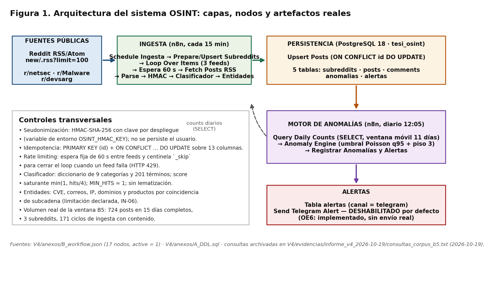
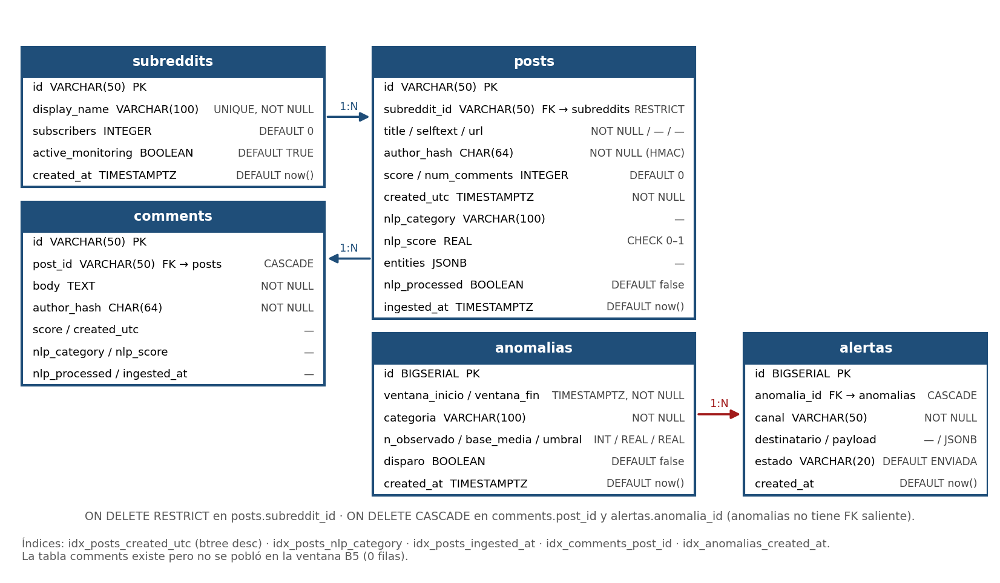
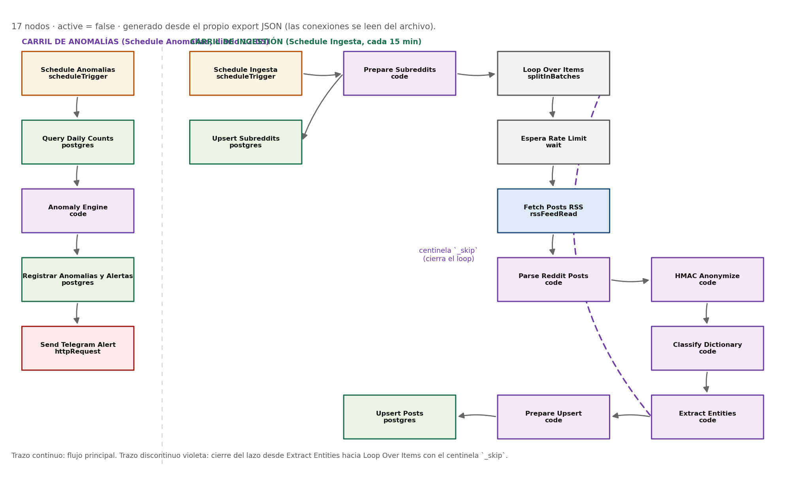
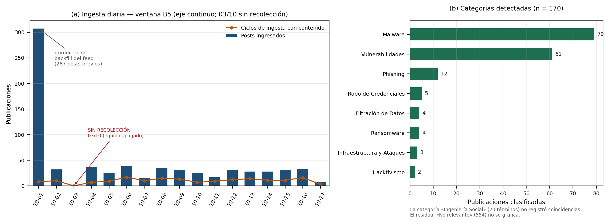

# SISTEMA AUTOMATIZADO DE MONITOREO DE FOROS Y REDES SOCIALES PARA LA DETECCIÓN DE TENDENCIAS Y ALERTAS EN CIBERSEGURIDAD EN ARGENTINA MEDIANTE OSINT Y N8N

**Universidad Tecnológica Nacional — Facultad Regional Mendoza**
Tecnicatura Universitaria en Programación

Trabajo Final de Inserción para optar al título de Técnico Universitario en Programación

**Autores:** Valentino Lorca · Jerónimo Zúñiga · Enzo Severino
**Directores / Profesores:** Prof. Alberto Cortez · Prof. Ariel Enferrel
Mendoza, Argentina — 2026

> **Versión del documento (V4).** Esta es la cuarta versión del informe y la reentrega solicitada por el tribunal tras la evaluación de la V3. Se reconstruye sobre la base textual de la V2 e incorpora el sistema efectivamente implementado y los datos realmente relevados. El corpus evaluado es el correspondiente a la ventana de recolección **B5**, cerrada con corte **17/10/2026** y compuesta por **724 publicaciones** de **3 subreddits** relevadas en **16 fechas** (el 03/10/2026 no hubo recolección). Los datos que respaldan cada tabla y figura de este informe están archivados con su consulta, su fecha y su `n` en `V4/evidencias/informe_v4_2026-10-19/` y en las evidencias previas del repositorio del proyecto.
>
> **Declaración de autoría y de uso de herramientas de asistencia.** La concepción del problema, el diseño del sistema, la operación del pipeline, el etiquetado de la muestra de control y la interpretación de los resultados son de los autores. Se utilizaron asistentes de programación basados en modelos de lenguaje para la escritura y revisión de código de los nodos, la redacción de documentación técnica interna y la verificación de formato de este informe. Ninguna cifra publicada fue generada por un asistente: todas provienen de consultas `SELECT` sobre la base `tesi_osint` o de archivos de evidencia fechados que se citan en el propio texto.

## Índice general

1. Introducción
2. Marco teórico y estado del arte
3. Marco metodológico
4. Desarrollo del sistema
5. Resultados
6. Discusión
7. Conclusiones
8. Recomendaciones y trabajos futuros
9. Referencias bibliográficas
10. Anexos A–D

## Índice de tablas

- Tabla 1.1. Criterios de éxito definidos a priori y estado en la V4
- Tabla 3.1. Aplicación de las fases de la DSR al trabajo
- Tabla 4.1. Inventario de nodos del workflow desplegado
- Tabla 4.2. Atributos del esquema físico (espejo de `A_DDL.sql`)
- Tabla 5.1. Corpus de la ventana B5 por subreddit
- Tabla 5.2. Recolección diaria de la ventana B5
- Tabla 5.3. Clasificación temática del corpus
- Tabla 5.4. Latencia extremo a extremo de la ingesta
- Tabla 5.5. Disparos del motor de anomalías
- Tabla 5.6. Evaluaciones del motor por categoría
- Tabla 5.7. Muestra de control: matriz binaria (clasificador vigente)
- Tabla 5.8. Métricas de clasificación e intervalos de confianza exactos
- Tabla 5.9. Efecto de la corrección del umbral del clasificador
- Tabla 5.10. Errores y desacuerdos del clasificador vigente
- Tabla 5.11. Casos representativos del corpus B5
- Tabla 5.12. Síntesis del cumplimiento de los criterios de éxito
- Tabla 6.1. Contraste con el antecedente local (Dengra y Rivas, 2026)
- Tabla 7.1. Trazabilidad de los criterios de éxito
- Tabla 7.2. Trazabilidad de los objetivos específicos
- Tabla 8.1. Recomendaciones para el sistema en producción
- Tabla B.1. Inventario de nodos y responsabilidades (Anexo B)
- Tabla C.1. Diccionario de categorías y términos (Anexo C)

## Índice de figuras

- Figura 1. Arquitectura del sistema OSINT: capas, nodos y artefactos reales
- Figura 2. Modelo entidad-relación del esquema físico
- Figura 3. Grafo de nodos y conexiones del workflow desplegado
- Figura 4. Serie temporal de la ingesta y categorías detectadas

## Siglas

**B5**: ventana de recolección «B5» del proyecto. **DDL**: *Data Definition Language*, lenguaje de definición de datos. **DSR**: *Design Science Research*, investigación en ciencia del diseño. **ETL**: *Extract, Transform, Load*. **FN/FP**: falso negativo y falso positivo. **HMAC**: *Hash-based Message Authentication Code*. **NLP**: *Natural Language Processing*, procesamiento de lenguaje natural. **OE**: objetivo específico. **OSINT**: *Open Source Intelligence*. **PI**: pregunta de investigación. **P50/P95**: percentil 50 y percentil 95. **RSS/Atom**: formatos de sindicación de contenidos web. **SOCMINT**: *Social Media Intelligence*. **TTP**: tácticas, técnicas y procedimientos. **TN/TP**: verdadero negativo y verdadero positivo.

---

# RESUMEN

El presente Trabajo Final de Inserción detalla el diseño, desarrollo, implementación y evaluación de un sistema automatizado de monitoreo de comunidades digitales, concebido para recolectar, procesar, almacenar y analizar información pública relevante en el ámbito de la ciberseguridad en la República Argentina, enmarcado en el paradigma de la Inteligencia de Fuentes Abiertas (OSINT). El proyecto aborda la problemática de la dispersión, heterogeneidad y falta de estructuración de los datos disponibles en internet, que dificultan la detección oportuna de amenazas y vulnerabilidades. La solución implementada integra herramientas de código abierto: n8n 2.40.6 para la orquestación de un pipeline ETL, PostgreSQL 18 para el almacenamiento relacional estructurado y un clasificador heurístico bilingüe, ejecutado dentro del propio orquestador, para la categorización de incidentes.

La recolección se realizó sobre la fuente pública de Reddit en formato RSS/Atom (`new/.rss`) de tres comunidades con monitoreo activo: r/netsec, r/Malware y r/devsarg. El corpus analizado corresponde a la ventana de recolección cerrada el 17/10/2026 y está compuesto por **724 publicaciones** persistidas entre el 01/10/2026 y el 17/10/2026, con **15 fechas de evaluación** registradas por el motor de anomalías. El flujo se ejecutó cada 15 minutos, con una espera fija entre comunidades para respetar los límites de la plataforma, y aplicó una seudonimización irreversible de los autores mediante HMAC-SHA-256 con clave por despliegue antes de persistir cada registro.

Sobre ese corpus, el clasificador —9 categorías y 201 términos, con una puntuación saturante `min(1, hits/4)` y umbral mínimo de una coincidencia— determinó que el 76,52 % de las publicaciones no era relevante y asignó las 170 restantes a 8 categorías de amenaza, con predominio de Malware (79) y Vulnerabilidades (61). El motor de detección evaluó 8 categorías en 15 fechas mediante un umbral de Poisson calibrado sobre una ventana móvil de 11 días, con un piso absoluto de 3 eventos, y registró 6 disparos. La muestra de control de 50 publicaciones etiquetadas manualmente por un único anotador arrojó una precisión, una sensibilidad y un F1-score de **0,931** cada uno, con una exactitud de categoría del **84,0 %** y una tasa de falsos descubrimientos del **6,9 %**.

Los resultados son deliberadamente presentados con su alcance: el criterio de cobertura se retira por no ser verificable con una única fuente y una única captura; el criterio de latencia extremo a extremo (≤ 5 minutos) **no se cumple** (P95 medido de 1.376 minutos sobre las publicaciones creadas dentro de la ventana), y el criterio de throughput (≥ 1.000 posts/hora) tampoco se verifica en operación, donde el sistema procesó alrededor de 45 publicaciones por día. El módulo de alertas quedó implementado y deshabilitado por defecto, sin evidencia de envío real. El informe documenta el marco legal de protección de datos personales bajo la Ley Nacional 25.326 y el Decreto 1558/2001, los principios de minimización y seudonimización aplicados y el riesgo residual que persiste sobre datos potencialmente reidentificables.

**Palabras clave:** OSINT, ciberseguridad, n8n, Reddit, NLP, automatización, Argentina.

# ABSTRACT

This Final Insertion Project presents the design, development, implementation and evaluation of an automated monitoring system for digital communities, built to harvest, process, store and analyze publicly available information relevant to cybersecurity in Argentina within the Open Source Intelligence (OSINT) paradigm. The project addresses the dispersion, heterogeneity and lack of structure of publicly available data, which hinder the timely detection of threats and vulnerabilities. The implemented solution integrates open-source tools: n8n 2.40.6 for ETL pipeline orchestration, PostgreSQL 18 for structured relational storage, and a bilingual heuristic classifier running inside the orchestrator for incident categorization.

Collection was performed against Reddit's public RSS/Atom feeds (`new/.rss`) of three actively monitored communities: r/netsec, r/Malware and r/devsarg. The analyzed corpus corresponds to the collection window closed on 2026-10-17 and comprises **724 posts** persisted between 2026-10-01 and 2026-10-17, with **15 evaluation dates** recorded by the anomaly engine. The workflow ran every 15 minutes with a fixed wait between communities to respect platform limits, and applied irreversible pseudonymization of authors through HMAC-SHA-256 with a per-deployment key before persisting each record.

On that corpus, the classifier —9 categories and 201 terms, with a saturating score `min(1, hits/4)` and a minimum threshold of one match— found 76.5 % of posts irrelevant and assigned the remaining 170 to 8 threat categories, dominated by Malware (79) and Vulnerabilities (61). The detection engine evaluated 8 categories across 15 dates using a Poisson threshold calibrated on an 11-day moving window with an absolute floor of 3 events, and recorded 6 triggers. A control sample of 50 manually labeled posts, annotated by a single annotator, yielded precision, recall and F1-score of **0.931** each, exact category accuracy of **84.0 %**, and a false positive rate of **6.9 %**.

Results are deliberately reported with their scope: the coverage criterion is withdrawn because it is not verifiable with a single source and a single capture; the end-to-end latency criterion (≤ 5 minutes) is **not met** (measured P95 of 1,376 minutes for posts created within the window), and the throughput criterion (≥ 1,000 posts/hour) is not verified in operation, where the system processed about 45 posts per day. The alerting module is implemented but disabled by default, with no evidence of real delivery. The report documents the personal data protection legal framework under Argentina's National Law 25.326 and Decree 1558/2001, the minimization and pseudonymization principles applied, and the residual risk that persists over potentially re-identifiable data.

**Keywords:** OSINT, cybersecurity, n8n, Reddit, NLP, automation, Argentina.

---

# CAPÍTULO 1: INTRODUCCIÓN

## 1.1. Contextualización del problema

En la era digital contemporánea, las tecnologías de la información y la comunicación han reconfigurado las estructuras socioeconómicas, organizacionales y operativas a nivel global. La digitalización masiva de procesos críticos, transacciones comerciales y canales comunicacionales ha impulsado una proliferación sin precedentes de datos. Diariamente, millones de usuarios generan contenido en redes sociales, blogs, foros y plataformas especializadas, compartiendo experiencias, conocimiento técnico, opiniones e incidentes de diversa índole. Dentro del ámbito de la ciberseguridad, esta dinámica dio origen a un fenómeno de particular relevancia: las comunidades virtuales y los foros abiertos se convirtieron en repositorios primarios de información sobre amenazas emergentes, filtraciones de datos, vectores de ataque activos y vulnerabilidades recién divulgadas.

Con frecuencia, los detalles de un ataque, las tácticas, técnicas y procedimientos (TTP) de un grupo delictivo o la explotación de una nueva vulnerabilidad se discuten e informan en foros abiertos antes de ser publicados en boletines oficiales de ciberseguridad o reportados por los proveedores de software. Esto se debe a que la velocidad con la que opera la comunidad de investigadores, entusiastas y actores maliciosos en internet supera holgadamente los ciclos de auditoría de los organismos tradicionales de seguridad de la información (Glassman y Kang, 2012). En este contexto surge la necesidad de adoptar metodologías de Inteligencia de Amenazas (*Cyber Threat Intelligence*, CTI) respaldadas por el paradigma de la Inteligencia de Fuentes Abiertas (*Open Source Intelligence*, OSINT) para recolectar y procesar esa información pública.

## 1.2. Planteamiento del problema

A pesar del valor estratégico de la información disponible en plataformas abiertas, su explotación efectiva por parte de los equipos de ciberseguridad, los centros de operaciones de seguridad (SOC) y los analistas de la República Argentina se ve obstaculizada por factores técnicos y metodológicos. En primer lugar, el volumen y la tasa de generación de los datos: el monitoreo manual de múltiples foros, canales y redes sociales resulta inviable por las limitaciones del factor humano para procesar flujos continuos de información las 24 horas del día. En segundo lugar, la información se encuentra dispersa de manera heterogénea y fragmentada en decenas de comunidades digitales, cada una con sus propios formatos, terminologías y estructuras de datos (Pastor-Galindo et al., 2020).

En tercer lugar, los datos carecen de estructuración formal: consisten predominantemente en texto libre en lenguaje natural, con modismos, jerga técnica y ruido semántico, lo que impide un análisis cuantitativo directo mediante sistemas de bases de datos tradicionales. En cuarto lugar, la disponibilidad de herramientas automatizadas, accesibles y adaptadas al contexto local es limitada, lo que dificulta la detección oportuna de tendencias específicas y la generación de alertas tempranas. Finalmente, la implementación de sistemas de recolección persistente debe conciliarse con los marcos éticos y legales vigentes, en especial la Ley Nacional 25.326 de Protección de Datos Personales.

Un aspecto que este trabajo incorpora explícitamente al planteamiento del problema es la **restricción de acceso programático** a las plataformas. La disponibilidad de interfaces de programación cambió de forma sustancial durante los últimos años: los accesos gratuitos a archivos históricos de terceros fueron discontinuados y las interfaces oficiales quedaron sujetas a autenticación, cuotas y políticas de uso que condicionan tanto el volumen como la profundidad temporal de la recolección posible. El diseño del sistema debió asumir esa restricción como una variable del problema y no como un detalle de implementación, tal como se documenta en el Capítulo 2 y en el Anexo B.

## 1.3. Justificación del proyecto

La viabilidad de implementar sistemas basados en OSINT en ciberseguridad se fundamenta en su bajo costo operativo, su alta accesibilidad y la riqueza de la información disponible públicamente. Automatizar la captura y el procesamiento de estos datos permite reducir el esfuerzo manual de los equipos de seguridad, de modo que los analistas concentren su capacidad en la toma de decisiones estratégicas de mitigación y en la respuesta ante incidentes (Russell y Klassen, 2019). La justificación de este proyecto radica en proponer una solución tecnológica robusta, modular y de bajo costo para el contexto argentino. La integración de n8n como orquestador de flujos visuales tipo ETL permite una alta adaptabilidad para incorporar nuevas fuentes sin reescribir componentes de infraestructura, mientras que la persistencia en PostgreSQL garantiza un almacenamiento relacional íntegro y auditable, y el clasificador heurístico en español aporta la capacidad de estructurar y categorizar automáticamente el contenido en el idioma local.

La elección de un clasificador por diccionario —en lugar de un modelo estadístico o de un modelo de lenguaje— responde a tres razones explícitas: la interpretabilidad del resultado (cada categoría se puede explicar por los términos que la activaron), el costo computacional nulo en términos de infraestructura de entrenamiento y la adecuación al alcance de un trabajo final de tecnicatura. Esa decisión tiene un costo conocido, que este informe declara: el diccionario no lematiza, de modo que reconoce variantes flexivas solo cuando están incluidas como términos, y su desempeño depende de la cobertura léxica del dominio.

## 1.4. Delimitación y alcance

**Delimitación de fuentes.** Se seleccionó la plataforma Reddit como caso de estudio y fuente principal por su estructura temática organizada en *subreddits*, que permite acotar la búsqueda a comunidades donde se agrupan usuarios con interés en tecnología, desarrollo de software y seguridad informática. La recolección se realiza sobre las **fuentes públicas de sindicación RSS/Atom** que la plataforma expone (`https://www.reddit.com/r/<comunidad>/new/.rss?limit=100`), sin autenticación, y no sobre la interfaz de programación con OAuth2. Las consecuencias de esa elección —menor profundidad temporal, dependencia del tamaño del *feed* y exposición a limitación de tasa— se describen en 2.1.2 y se cuantifican en el Capítulo 5.

**Delimitación geográfica.** El trabajo se orienta al territorio de la República Argentina. La delimitación geográfica se expresa en la selección de comunidades y de vocabulario: los subreddits con monitoreo activo al cierre de la ventana son **r/devsarg** (comunidad de desarrolladores argentinos), **r/Malware** y **r/netsec** (comunidades internacionales de análisis técnico, incorporadas por su densidad de reportes verificables), y el diccionario incluye términos de uso local en español rioplatense. Las comunidades **r/argentina** y **r/derechogenial** fueron dadas de baja del monitoreo activo (`active_monitoring = false`) después de la evaluación preliminar, porque no aportaron detecciones de amenaza y su inclusión elevaba el ruido del corpus: el canal legal registró 0 amenazas reales sobre 10 publicaciones etiquetadas y 3 falsos positivos del clasificador. Esa decisión se documenta y se cuantifica en 5.2 y 6.3.

**Delimitación temporal.** La ventana nominal de recolección (B5) se declaró el 25/09/2026; el primer registro persistido corresponde al **01/10/2026** y el último día con recolección oficial es el **17/10/2026**, fecha en la que se fijó el corte. La ventana se cerró al alcanzar el objetivo de **15 fechas de evaluación** registradas por el motor de anomalías (mínimo exigido: 10). La recolección posterior al corte existe y continúa como track secundario de respaldo, pero **no integra el corpus evaluado** de este informe.

**Delimitación temática.** El análisis semántico se restringe a incidentes y discusiones de seguridad de la información: *malware*, vulnerabilidades, *phishing*, robo de credenciales, filtración de datos, *ransomware*, infraestructura y ataques, hacktivismo e ingeniería social. La taxonomía vigente del clasificador contiene 9 categorías y 201 términos; en el corpus analizado se activaron 8 de esas 9 categorías.

**Fuera de alcance.** No forman parte de este trabajo: la recolección de comentarios (la tabla `comments` del modelo existe pero no se pobló en la ventana evaluada), las fuentes que requieren credenciales o consentimiento (mensajería privada, foros cerrados, *dark web*), la ejecución de un banco de pruebas comparativo contra herramientas comerciales o de código abierto sobre el mismo corpus, y la verificación de envío real de alertas a un canal externo.

## 1.5. Objetivos de la investigación

**Objetivo general.** Diseñar, desarrollar, implementar y evaluar un sistema automatizado de monitoreo basado en el paradigma OSINT, utilizando las fuentes públicas de Reddit, la herramienta de orquestación de flujos n8n y el motor de base de datos PostgreSQL, capaz de recolectar, procesar, estructurar, analizar y generar alertas tempranas sobre incidentes de ciberseguridad en Argentina de manera eficiente, auditable y con estricto apego al marco legal nacional.

**Objetivos específicos.**

- **OE1.** Recolectar automáticamente publicaciones desde las **fuentes públicas de Reddit (RSS/Atom)** de las comunidades seleccionadas, gestionando de manera explícita las restricciones de tasa de la plataforma y documentando el efecto de esas restricciones sobre el alcance temporal del corpus.
- **OE2.** Diseñar e implementar flujos de trabajo robustos en n8n para la extracción, limpieza, normalización y transformación de los datos, garantizando la **idempotencia** del pipeline y su recuperación ante fallos parciales de las fuentes.
- **OE3.** Modelar y desplegar una base de datos relacional PostgreSQL con restricciones de integridad referencial e índices orientados a las consultas analíticas, para el almacenamiento seguro de los metadatos y contenidos recolectados.
- **OE4.** Desarrollar un componente de procesamiento de lenguaje natural en español capaz de categorizar semánticamente los textos y extraer entidades tecnológicas críticas, y describir con precisión su alcance y sus límites.
- **OE5.** Implementar un motor de reglas estadísticas para la detección automática de anomalías y tendencias emergentes en el flujo continuo de datos.
- **OE6.** **Diseñar y configurar** un sistema automatizado de generación de alertas integrado con plataformas de mensajería, dejando explícito su estado operativo al cierre de la ventana.
- **OE7.** Evaluar cuantitativamente el rendimiento del sistema mediante métricas de precisión, *recall*, F1-score, latencia, throughput y tasa de falsos descubrimientos en un entorno operativo real, comparando cada resultado con los umbrales definidos a priori.
- **OE8.** Analizar los aspectos legales, regulatorios y éticos vinculados a la recolección y el procesamiento de datos de fuentes abiertas en Argentina, implementando mecanismos efectivos de seudonimización en cumplimiento de la Ley 25.326.

## 1.6. Supuesto de trabajo y criterios de éxito

De acuerdo con la metodología *Design Science Research* (DSR) adoptada, se establece el siguiente supuesto de trabajo:

> Un sistema de monitoreo OSINT de código abierto, basado en n8n y PostgreSQL, con un componente de clasificación heurística especializado en español, puede automatizar la detección de incidentes de ciberseguridad en comunidades de Reddit con niveles de precisión y sensibilidad operativamente útiles, y a una fracción del costo de las soluciones propietarias.

**Criterios de éxito definidos a priori.** Los umbrales se establecieron en la etapa de diseño, antes de la fase de evaluación, con base en estándares de referencia de la industria para pipelines de clasificación de texto (Pastor-Galindo et al., 2020) y en los objetivos operativos del usuario final del sistema. La Tabla 1.1 los enumera junto con el estado que reciben en esta versión del informe.

**Tabla 1.1. Criterios de éxito definidos a priori y estado en la V4**

| Criterio | Umbral | Estado en la V4 |
|---|---|---|
| Precisión de la clasificación | ≥ 80 % | Se evalúa en 5.5 |
| Sensibilidad (*recall* de clasificación) | ≥ 80 % | Se evalúa en 5.5 |
| F1-score de clasificación | ≥ 0,80 | Se evalúa en 5.5 |
| Tasa de falsos descubrimientos | ≤ 20 % | Se evalúa en 5.5 |
| Latencia extremo a extremo | ≤ 5 minutos | **NO CUMPLIDO** (5.3) |
| Throughput del pipeline | ≥ 1.000 posts/hora | **NO CUMPLIDO** (5.7) |
| Cobertura de recolección | ≥ 80 % | **Retirada** (ver nota) |

> **Nota metodológica sobre la cobertura.** La versión previa de este informe declaraba un criterio de cobertura del 80 % y lo reportaba como superado. La V4 **retira ese criterio**. La razón es que su verificación requiere un diseño de captura–recaptura sobre fuentes independientes, y este trabajo dispone de una única fuente y de una única captura: cualquier cifra de cobertura calculada sobre el propio corpus sería un cociente sin denominador verificable. El tribunal de la V3 admitió explícitamente esta salida —retirar la métrica antes que presentarla como parcial sin justificación—. En consecuencia, la cobertura no aparece en el Resumen, en el Capítulo 5 ni en el Capítulo 7, y el análisis de la *representatividad* del corpus se hace de forma cualitativa y con las limitaciones declaradas en 6.3.
>
> **Nota metodológica sobre el F1-score.** El F1-score se incorpora aquí como criterio propio, con umbral explícito, para evitar la redundancia señalada en la evaluación anterior, donde la precisión y la tasa de falsos descubrimientos describían en parte el mismo fenómeno: ambas se derivan de los mismos verdaderos y falsos positivos, y su presentación conjunta como dos criterios independientes sugería una validación más amplia que la realmente existente. La tasa de falsos descubrimientos se reporta con su fórmula explícita, `FP / (TP + FP)`, que no estaba definida en la versión previa.
>
> **Nota metodológica sobre el cambio de umbral de clasificación.** La versión previa declaraba los umbrales de clasificación en 82 % de precisión y 18 % de falsos descubrimientos. Se declara aquí que ambos valores **se modificaron a 80 % y 20 %** y se explicita la razón: las dos cifras eran complementarias —`FP / (TP + FP) = 1 − precisión` cuando no se cuentan los falsos negativos en el denominador—, de modo que no eran dos criterios sino uno expresado dos veces, y el valor 82 % no tenía derivación declarada. En esta versión se conserva un único umbral de precisión del 80 %, alineado con el valor que la tabla aplica también a sensibilidad y a F1, y la tasa de falsos descubrimientos se reporta como su complemento explícito. El cambio es previo a la observación de resultados y **no altera ninguna conclusión**, porque el valor alcanzado (93,1 % de precisión, 6,9 % de falsos descubrimientos) supera ambos conjuntos de umbrales, el anterior y el vigente.

Los criterios aquí listados **no fueron modificados después de observar los resultados**. Los dos criterios que no se alcanzan (latencia y throughput) se informan como no cumplidos en el Capítulo 5 y se retoman en los Capítulos 6 y 7.

## 1.7. Preguntas de investigación

- **PI-1.** ¿En qué medida un sistema basado en herramientas de código abierto (n8n y PostgreSQL) puede ofrecer una arquitectura técnicamente viable y de bajo costo en comparación con soluciones propietarias de monitoreo OSINT, en términos de costo, flexibilidad y rendimiento medible sobre el mismo dominio de datos?
- **PI-2.** ¿Cuáles son los principales patrones temporales y temáticos de incidentes de ciberseguridad discutidos por comunidades digitales vinculadas a Argentina durante el período relevado?
- **PI-3.** ¿Cómo afectan las restricciones de acceso programático de las plataformas —cuotas, políticas de uso y discontinuación de archivos históricos— a la cobertura y a la profundidad temporal de un pipeline de ingesta automatizado?
- **PI-4.** ¿De qué manera se puede proteger la privacidad de los usuarios en un sistema de monitoreo público persistente, en cumplimiento de la normativa argentina?

# CAPÍTULO 2: MARCO TEÓRICO Y ESTADO DEL ARTE

## 2.1. Marco conceptual

### 2.1.1. Inteligencia de fuentes abiertas (OSINT)

El término Inteligencia de Fuentes Abiertas (*Open Source Intelligence*, OSINT) se refiere al proceso sistemático y estructurado de recopilar, procesar, analizar y explotar datos de acceso público en internet para convertirlos en inteligencia accionable destinada a la toma de decisiones estratégicas, operativas o tácticas (Russell y Klassen, 2019). El OSINT se rige por un ciclo de inteligencia clásico de cinco fases: planificación y dirección, recolección de datos, procesamiento y estructuración, análisis y producción de inteligencia, y difusión (Pastor-Galindo et al., 2020). Este trabajo se apoya en ese ciclo como esquema organizativo: la planificación y la dirección corresponden a la definición de objetivos y criterios del Capítulo 1; la recolección y el procesamiento, al pipeline descrito en el Capítulo 4; y el análisis, la producción y la difusión, al motor de anomalías y al módulo de alertas.

Las fuentes OSINT se clasifican en varias categorías: registros de dominios y bases de datos de DNS, repositorios de código público, motores de búsqueda especializados de infraestructura y medios sociales. Los medios sociales y los foros interactivos representan una subcategoría crítica conocida como *Social Media Intelligence* (SOCMINT). A diferencia del OSINT técnico, centrado en infraestructura, SOCMINT se ocupa del contenido generado por usuarios y aporta una perspectiva sobre las dinámicas humanas detrás del ciberdelito: cómo se nombran los incidentes, qué se discute antes de que exista un reporte oficial y qué vocabulario circula en una comunidad determinada (Glassman y Kang, 2012). Este trabajo se ubica en esa subcategoría.

### 2.1.2. Reddit como fuente de inteligencia

Reddit se organiza en foros moderados y autogestionados denominados *subreddits*. Su naturaleza pseudónima y su enfoque comunitario orientado a la discusión técnica atraen a ingenieros de software, administradores de sistemas e investigadores de seguridad. A diferencia de las plataformas de microblogging, Reddit fomenta publicaciones extensas y debates detallados organizados en hilos ramificados (Russell y Klassen, 2019), lo que resulta especialmente adecuado para un clasificador que opera sobre texto.

El acceso automatizado a Reddit atravesó cambios regulatorios sustanciales entre 2023 y 2026. Tras la modificación de los términos de servicio de su interfaz de programación en 2023, se discontinuó el acceso libre a plataformas de archivo histórico de terceros, el acceso programático gratuito pasó a exigir autenticación mediante OAuth2 y quedó sujeto a un límite nominal de consultas por minuto, además de un techo de aproximadamente 1.000 ítems por punto de acceso de listado (Reddit Inc., 2026).

En el contexto de este proyecto, ese régimen de acceso tuvo una consecuencia concreta que condicionó el diseño: el endpoint público en formato JSON resultó inaccesible por política de la plataforma —la respuesta observada fue **HTTP 403**, no un error de cuota—, de modo que la recolección se instrumentó sobre las **fuentes de sindicación RSS/Atom** que la plataforma expone en `https://www.reddit.com/r/<comunidad>/new/.rss?limit=100`, que no requieren autenticación. La caracterización de ese acceso, documentada en `V4/evidencias/CARACTERIZACION_RATE_LIMIT.md` (2026-09-25, revisada el 2026-09-30), establece lo siguiente:

- El síntoma relevante es **HTTP 429 (Too Many Requests)** ante el exceso de solicitudes desde la dirección del proyecto, y su alcance es la descarga del *feed*: la comunidad afectada puede quedar con **0 publicaciones en el ciclo**.
- El **umbral exacto** de solicitudes que dispara el 429 quedó registrado como **`no determinado`**: aislarlo empíricamente habría requerido generar más solicitudes, es decir, más bloqueos y más sesgo de cobertura. La guía del proyecto menciona un valor de referencia público del orden de 10 solicitudes por minuto, pero ese valor no fue verificado empíricamente para la dirección del proyecto.
- La mitigación vigente combina tres mecanismos: una **espera fija de 60 segundos** entre comunidades (una solicitud por minuto, por debajo del valor de referencia), reintentos acotados ante respuestas 429/403 y un **centinela** que cierra el ciclo del lazo de control cuando una fuente devuelve cero elementos, de modo que el resto de las comunidades no se saltee silenciosamente.
- El efecto residual sobre el corpus es un **sesgo por comunidad**: una comunidad puede no aportar datos en un ciclo determinado sin que el sistema lo declare como error. Ese efecto se midió el 02/10/2026: de 28 corridas automáticas, **15 fueron incompletas (53,6 %)**, concentradas en la comunidad que recibe el tercer turno del ciclo (`V4/evidencias/VENTANA_B5.md`, §13).

Las RSS/Atom, a diferencia de la interfaz con autenticación, no exponen métricas de interacción ni el árbol de comentarios, y devuelven solo los elementos más recientes del listado (hasta 100 por consulta). Esas dos limitaciones explican por qué la tabla `comments` del modelo quedó sin poblar y por qué la profundidad temporal del corpus es acotada.

### 2.1.3. Ciencia de datos, minería de datos y procesamiento de lenguaje natural

Para transformar el texto no estructurado en datos cuantitativos legibles por máquinas es indispensable articular técnicas de ciencia de datos, minería de datos y procesamiento de lenguaje natural. La minería de datos se ocupa de la extracción de patrones y relaciones en conjuntos de datos (Han et al., 2012); el procesamiento de lenguaje natural provee el marco algorítmico para que los programas interpreten y procesen lenguaje humano en formato digital (Jurafsky y Martin, 2009).

El pipeline de NLP **previsto en el diseño** contemplaba tokenización, normalización (minúsculas y remoción de caracteres especiales), eliminación de palabras vacías (*stop words*) y lematización morfológica para reducir cada palabra a su raíz. El pipeline **efectivamente implementado** es más acotado y conviene describirlo con precisión, porque de esa diferencia depende la interpretación de los resultados del Capítulo 5:

1. **Normalización**: conversión a minúsculas y remoción de diacríticos mediante descomposición Unicode NFD. Esto resuelve el tratamiento de tildes sin afectar la comparación, porque la normalización se aplica tanto al texto como a los términos del diccionario.
2. **Tokenización**: segmentación del texto por todo carácter que no sea alfanumérico, lo que produce un conjunto de palabras.
3. **Coincidencia**: los términos de una sola palabra se buscan por **igualdad exacta** contra ese conjunto; los términos compuestos se buscan por **coincidencia de subcadena** sobre el texto normalizado.
4. **Ausencia de lematización y de eliminación de palabras vacías**: no se aplica *stemming* ni lematización morfológica, y no se remueven *stop words*. En consecuencia, una variante flexiva que no esté incluida como término del diccionario no se reconoce por su raíz; la mitigación adoptada es incluir las variantes más frecuentes del dominio como términos independientes.

Esta decisión de ingeniería prioriza la interpretabilidad y el costo computacional nulo en infraestructura: cada categoría asignada es explicable por los términos que la activaron, y no requiere entrenamiento ni dependencias de modelos preentrenados. Su costo es un techo de desempeño asociado a la cobertura léxica, que se discute en 6.3.

### 2.1.4. Arquitecturas ETL y herramientas de automatización

Un pipeline de datos robusto para el monitoreo automatizado se rige por el patrón de diseño ETL (*Extract, Transform, Load*). En este sistema, la extracción consulta las fuentes públicas de sindicación; la transformación limpia, normaliza, seudonimiza y clasifica; y la carga persiste los registros en la base relacional. Para coordinar el flujo de manera modular y tolerante a fallos se adoptó **n8n** en su versión **2.40.6**, desplegada en Docker: una plataforma de automatización de flujos de trabajo de código abierto que permite integrar fuentes, bases de datos y servicios de mensajería mediante una interfaz visual y lógica programática en JavaScript (n8n GmbH, 2026). La persistencia se realiza en **PostgreSQL 18**, con un modelo relacional que se describe en el Capítulo 4 (PostgreSQL Global Development Group, 2026).

La elección de n8n sobre una alternativa basada en scripts propios responde a razones verificables en el desarrollo de este trabajo: el disparador temporal, el control de concurrencia por lotes, la espera entre solicitudes, el manejo de errores por nodo y la sentencia de *upsert* son componentes nativos, y el flujo completo queda exportable como un artefacto versionable (Anexo B). Esa exportabilidad es la que permite auditar que lo descrito en el informe coincida con lo ejecutado.

## 2.2. Estado del arte y brecha de conocimiento

En el ámbito profesional y académico existen herramientas consolidadas para la recolección de información OSINT. Entre las soluciones de código abierto de mayor difusión se destacan SpiderFoot, Maltego CE, theHarvester, Recon-ng:

- **SpiderFoot** automatiza el escaneo de infraestructura técnica (direcciones IP, subdominios, certificados) y el enriquecimiento de indicadores, pero no ofrece análisis semántico profundo sobre contenido social en español.
- **Maltego CE** provee un motor sólido de visualización de grafos de relaciones, pero requiere ejecuciones manuales y sus transformaciones para foros sociales en español son limitadas.
- **theHarvester** y **Recon-ng** están orientadas al reconocimiento pasivo en pruebas de penetración, sin capacidad de monitoreo temporal continuo ni de clasificación temática de texto libre.

En el plano académico, Liao et al. (2016) abordan la extracción automática de indicadores de compromiso desde fuentes abiertas de inteligencia de amenazas y muestran que la calidad de los indicadores depende críticamente de la normalización y del filtrado del texto; ese hallazgo es directamente aplicable a la decisión de este trabajo de priorizar la trazabilidad de cada categoría asignada. Zong et al. (2019) analizan la severidad percibida de las amenazas de ciberseguridad a partir del lenguaje con que se las describe en redes sociales y muestran que ese lenguaje es ruidoso, heterogéneo y dependiente del contexto en que se publica; ese rasgo condiciona cualquier clasificación automática construida sobre texto social. El desafío se manifestó en este proyecto: el corpus es mayoritariamente en español rioplatense, con modismos que no aparecen en los vocabularios técnicos en inglés, y la muestra de referencia se construyó específicamente para este trabajo.

**Antecedente directo de la misma casa de estudios.** Dengra y Rivas (2026) presentan el *Observatorio OSINT: Diseño e implementación de un sistema de recolección y análisis del discurso público sobre ciberseguridad en Bluesky en América Latina y el Caribe*, Trabajo Final de Carrera de la misma carrera y facultad, dirigido por el mismo director que este trabajo. El antecedente es de lectura obligada porque comparte objetivo general y difiere en decisiones estructurales. El contraste se resume en seis puntos:

1. **Fuente y acceso.** El antecedente consume la interfaz pública de Bluesky (AT Protocol) con autenticación; este trabajo consume las fuentes públicas RSS/Atom de Reddit, precisamente porque la interfaz JSON resultó inaccesible por política de la plataforma. La vía elegida evita el bloqueo, pero limita los campos disponibles y la profundidad del listado.
2. **Escala y ventana.** El antecedente reporta **3.908 publicaciones** en **847 fechas** y cinco países; este trabajo reporta **724 publicaciones** en **16 fechas con recolección** y **15 fechas de evaluación**, sobre tres comunidades. La diferencia de escala es de un orden de magnitud y acota el alcance de las conclusiones de este informe.
3. **Sesgo de recencia.** El antecedente mide un sesgo de paginación severo (la primera página concentra el 54,1 % del contenido de los últimos seis meses y desde la cuarta página la recuperación cae a cero) y lo corrige ampliando la ventana de recolección. Este trabajo opera sobre el listado de novedades, por lo que su corpus está sesgado hacia lo reciente en la misma dirección: se declara en 6.3 y no se corrige.
4. **Clasificación.** El antecedente recupera por palabras clave y valida manualmente la **relevancia**; no categoriza. Este trabajo añade una taxonomía de 9 categorías y 201 términos, lo que habilita el análisis temático pero introduce una fuente de error que el antecedente no tiene. El antecedente documenta, además, un caso de ruido por coincidencia léxica (la palabra clave «CERT» resultó ruidosa en aproximadamente el **83 %** de los casos por colisión con la raíz «cert-» en portugués y catalán) y opta por retirarla; ese episodio es evidencia externa y contemporánea de que la coincidencia léxica sin lematización produce falsos positivos, exactamente el fenómeno que este trabajo declara como limitación propia.
5. **Validación y fiabilidad.** El antecedente construye una muestra de **n = 80** con semilla fija, script versionado y hash del archivo de origen, y la anota con **dos** evaluadores para calcular el **kappa de Cohen** (κ = 0,356 para relevancia temática y κ = 0,758 para país). Este trabajo usa **n = 50** y **un solo anotador**, por lo que no puede reportar acuerdo entre evaluadores. La comparación es incómoda y se declara: el antecedente tiene un mecanismo de fiabilidad que este trabajo no tiene.
6. **Marco legal y reutilización.** El antecedente invoca la Ley 25.326 y recomienda seudonimizar los identificadores antes de publicar los datos, además de advertir que la recolección multi-jurisdiccional exige adoptar el criterio más estricto disponible. Este trabajo aplica seudonimización irreversible en la etapa de ingesta, lo que respalda y anticipa esa recomendación.

**Brecha de conocimiento.** La brecha que este trabajo aborda no es la ausencia de herramientas OSINT, sino la ausencia de **sistemas de monitoreo continuo adaptados al léxico local y con un mecanismo de detección temporal** sobre comunidades de habla hispana. Las herramientas relevadas asumen el inglés como idioma estándar y no contemplan los modismos con los que los usuarios locales discuten estafas o incidentes: una caída de servicio se narra como «tiraron el sitio» o «se cayeron los servidores», una apropiación de cuenta como «me robaron la contraseña» o «me tomaron el control de la cuenta», y una extorsión como «me piden rescate» o «me bloquearon los archivos». Esos giros no aparecen en los vocabularios técnicos en inglés y son, sin embargo, los que un analista local necesita leer. El diccionario de este trabajo los incorpora de forma explícita (`tiraron el sitio`, `caeron los servidores`, `robaron mi contrasena`, `tomaron control de la cuenta`, `piden rescate`, `bloquearon mis archivos`, entre otros; Anexo C), y la contrapartida de esa decisión —comparar cadenas sin lematizar— es la causa de la mayoría de los falsos positivos declarados en 6.3. Los trabajos académicos disponibles o bien se centran en indicadores técnicos (Liao et al., 2016), o bien analizan el lenguaje de las amenazas sobre plataformas globales en inglés, sin anclaje local (Zong et al., 2019). El antecedente de Dengra y Rivas (2026) cubre el análisis del discurso en otra plataforma y con otro método. Este trabajo aporta, sobre esa base, un artefacto que además de recolectar y clasificar incorpora un motor de detección de anomalías con umbral estadístico explícito (Capítulo 4, sección 4.5) y un corpus fechado, auditable y con trazabilidad por consulta.

---

# CAPÍTULO 3: MARCO METODOLÓGICO

## 3.1. Tipo y diseño de la investigación

La presente investigación se enmarca en la modalidad de investigación aplicada tecnológica. Su propósito no se restringe a la teorización conceptual, sino al desarrollo, la validación y la evaluación de un artefacto de software concreto orientado a resolver una problemática operativa real. Para estructurar el desarrollo se adoptó el modelo de proceso de la *Design Science Research* (DSR) de seis fases —identificación del problema, definición de objetivos, diseño y desarrollo, demostración, evaluación y comunicación— (Peffers et al., 2007), complementado con los principios generales de diseño de artefactos tecnológicos (Hevner et al., 2004). La Tabla 3.1 explicita cómo se aplicó cada fase y qué producto verificable dejó cada una.

**Tabla 3.1. Aplicación de las fases de la DSR al trabajo**

| Fase DSR | Aplicación en este trabajo | Producto verificable |
|---|---|---|
| 1. Identificación del problema | Dispersión, volumen y falta de estructura de los datos de ciberseguridad en comunidades de habla hispana; restricciones de acceso programático | Capítulo 1, §1.1–1.2; `CARACTERIZACION_RATE_LIMIT.md` |
| 2. Objetivos y criterios a priori | Automatización, estructuración, categorización y alerta; umbrales cuantitativos | Capítulo 1, §1.6 |
| 3. Diseño y desarrollo | Pipeline en n8n, modelo relacional, clasificador por diccionario, motor de anomalías | Capítulo 4; `A_DDL.sql`; `B_workflow.json` |
| 4. Demostración | Recolección continua sobre tres comunidades; primera corrida con datos: 01/10/2026; corte: 17/10/2026 | `VENTANA_B5.md`; bitácora diaria |
| 5. Evaluación | Muestra de control etiquetada (30/09/2026) y lecturas de solo lectura sobre el corpus cerrado (19/10/2026) | `evaluacion_muestra_control_2026-09-30.*`; consultas archivadas |
| 6. Comunicación | Informe académico y documentación técnica del repositorio | Este documento; anexos A–D |

La metodología DSR contempla explícitamente la iteración entre fases. En este trabajo la iteración fue real y dejó huella documental: el primer corpus (denominado B4, 24/09/2026) fue descartado porque el diccionario y el umbral de coincidencia vigentes en ese momento producían una clasificación deficiente, y la recolección se reinició con el clasificador corregido. El corpus evaluado en este informe es el posterior a esa corrección.

## 3.2. Operacionalización del protocolo de recolección

Para garantizar la reproducibilidad del estudio se formalizó el protocolo operativo de extracción con los siguientes parámetros:

1. **Unidad de análisis.** La publicación (*post*). Cada fila del corpus corresponde a una publicación identificada por su identificador original de la plataforma, que actúa como clave primaria. Los comentarios no se recolectan (ver 1.4 y 4.3).
2. **Fuente y comunidades.** Tres comunidades con monitoreo activo: `r/netsec`, `r/Malware` y `r/devsarg`. La fuente es el listado público de novedades en formato RSS/Atom de cada comunidad, con un máximo de 100 elementos por consulta.
3. **Ciclo de ingesta.** El disparador opera cada **15 minutos**; en cada ciclo se recorre la lista de comunidades activas con un tamaño de lote de uno y una **espera fija de 60 segundos** entre solicitudes, por debajo del valor de referencia de tasa observado. Ante una respuesta 429 o 403 se reintenta hasta tres veces con una espera acotada entre intentos, y un centinela garantiza que el ciclo del lazo se cierre de manera consistente cuando una fuente no devuelve elementos.
4. **Deduplicación e idempotencia.** La clave primaria es el identificador de la publicación y la carga se realiza mediante `INSERT … ON CONFLICT (id) DO UPDATE`, de modo que reprocesar el mismo elemento actualiza el registro en lugar de duplicarlo. La propiedad de idempotencia se verificó ejecutando el flujo más de una vez sobre el mismo conjunto de entrada.
5. **Ventana temporal.** Ventana nominal declarada el **25/09/2026**; primer registro persistido el **01/10/2026**; último día con recolección oficial el **17/10/2026**, fecha fijada como corte el 19/10/2026. El límite superior del corpus es un instante fijo (inicio del día local siguiente al corte), de modo que el acumulado no depende del momento en que se consulte.
6. **Criterio de cierre.** La ventana se cierra al alcanzar el objetivo declarado de **15 fechas de evaluación** registradas por el motor de anomalías, con un mínimo exigido de 10, de manera de disponer de dos ciclos semanales completos para la calibración de la línea base.
7. **Naturaleza del corpus.** El corpus es un **censo** de lo recolectado, no una muestra: se analizan todas las publicaciones persistidas en la ventana. No se aplica ningún filtro posterior a la ingesta.
8. **Muestreo de anomalías.** El motor no muestrea: cuenta las publicaciones por categoría y por día local, y evalúa cada categoría presente en una ventana móvil de once días (sección 4.5).

## 3.3. Protocolo de validación del clasificador NLP

Para hacer auditables las métricas de precisión, sensibilidad y F1-score del Capítulo 5, se describe a continuación el protocolo de construcción de la muestra de referencia. Se distingue de forma explícita entre el **protocolo diseñado** y la **ejecución real**, porque no coinciden, y porque la evaluación previa de este trabajo fue penalizada precisamente por presentar como ejecutado un diseño que no se había ejecutado.

### 3.3.1. Protocolo diseñado

El diseño previsto establecía: (a) una muestra aleatoria estratificada proporcional por comunidad de origen; (b) etiquetado **independiente** y ciego por parte de los integrantes del equipo; (c) cálculo del **acuerdo entre evaluadores** mediante el coeficiente kappa, adoptando el umbral de acuerdo sustancial (κ ≥ 0,61) establecido por Landis y Koch (1977); y (d) resolución de las discrepancias **por mayoría de votos** entre los evaluadores, tomando la etiqueta de consenso como referencia (*ground truth*) contra la cual medir el clasificador automático.

### 3.3.2. Ejecución real

La muestra efectivamente construida y etiquetada el **30/09/2026** tiene las siguientes características, registradas en `V4/evidencias/evaluacion_muestra_control_2026-09-30.md` y `…json`:

- **Tamaño**: n = **50** publicaciones.
- **Diseño muestral**: estratificación **condicionada por la predicción del clasificador**, no proporcional. Se incluyó el **censo de las 28 publicaciones** que el sistema había marcado como amenaza —lo que permite medir errores de precisión— y **22 publicaciones sorteadas** del estrato «No relevante», con semilla declarada (**20260930**), lo que permite estimar de forma acotada la sensibilidad. Esta elección es deliberada: con un corpus de mayoría no relevante, una muestra proporcional habría contenido muy pocos casos positivos para evaluar la precisión.
- **Criterio de etiquetado**: cuenta como amenaza lo que describe un ataque o una campaña en curso, real y verificable, aunque se publique como reporte; no cuenta el material puramente educativo, de prevención o de catálogo. El criterio quedó textualmente asentado en la evidencia.
- **Anotadores**: **un único anotador** (uno de los autores). Por lo tanto, **no hay acuerdo entre evaluadores que reportar**.
- **Kappa**: **no calculable**, y no se reporta ninguna cifra de kappa. El coeficiente mide el acuerdo entre evaluadores y con un solo anotador carece de definición.

### 3.3.3. Consecuencias declaradas de la brecha entre diseño y ejecución

1. **No hay medida de fiabilidad del etiquetado.** Las métricas del Capítulo 5 son válidas respecto de un etiquetado único y reproducible, pero no informan sobre la estabilidad de ese etiquetado frente a un segundo evaluador. Es la limitación más importante de la evaluación.
2. **La sensibilidad no es publicable como propiedad del sistema sobre el corpus.** En el estrato sorteado de publicaciones predichas como «No relevante» (22 casos) la etiqueta humana marcó **2 como amenaza**, es decir una omisión del **9,1 %**, con un intervalo de confianza exacto del 95 % de **[1,1 %; 29,2 %]**. Esa amplitud impide estimar la omisión del sistema sobre el corpus con precisión útil, y por lo tanto **no se publica una cifra de sensibilidad poblacional**. El valor puntual se informa como orientación, no como resultado de la ventana. El mismo criterio se aplica a la precisión (`27/29 = 93,1 %`, IC 95 % [77,2 %; 99,2 %]) y a la tasa de falsos descubrimientos (`2/29 = 6,9 %`, IC 95 % [0,8 %; 22,8 %]).
3. **La muestra no permite estimar prevalencia.** La estratificación dependiente de la predicción garantiza que la proporción de amenazas en la muestra no represente la del corpus. Toda cifra de prevalencia del Capítulo 5 proviene del **recuento completo del corpus**, nunca de la muestra.
4. **Sesgo endógeno del diseño.** Como toda muestra estratificada sobre la salida del propio sistema, tiende a medir mejor la precisión que la cobertura. Se declara y se compensa parcialmente con el sorteo del estrato no relevante.

### 3.3.4. Reproducibilidad de la medición

Para evitar que las métricas dependieran de una reimplementación del diccionario, la evaluación final se hizo ejecutando el **nodo de código real del artefacto desplegado** sobre el texto exacto de las 50 publicaciones, comparando su salida contra la etiqueta humana (`V4/scripts/evaluar_muestra_reproducible.py`). Ese procedimiento permitió detectar y corregir un problema que la lectura directa de la base ocultaba: **3 filas conservaban la clasificación de una versión anterior del clasificador**, con una puntuación (`0,2`) que no pertenece a la escala vigente. Al reclasificarlas con el artefacto actual, la medición de la base subestimaba el desempeño. La corrección se documenta en la sección 5.b de la evidencia y sus efectos se cuantifican en la Tabla 5.9.

### 3.3.5. Definición operativa de las métricas

Sobre la clasificación binaria «amenaza / no amenaza» se definen: **TP** (el sistema indicó amenaza y la etiqueta humana también), **FP** (el sistema indicó amenaza y la etiqueta humana no), **FN** (el sistema no indicó amenaza y la etiqueta humana sí) y **TN** (ninguno de los dos indicó amenaza). Con esas cantidades:

- **Precisión** = `TP / (TP + FP)`
- **Sensibilidad (*recall*)** = `TP / (TP + FN)`
- **F1-score** = media armónica de precisión y sensibilidad
- **Tasa de falsos descubrimientos** = `FP / (TP + FP)`, con la misma base que la precisión, para evitar la ambigüedad de definirla sobre los negativos. Se adopta esta denominación —y no «tasa de falsos positivos»— porque el denominador son las predicciones positivas, no los negativos reales; su complemento es exactamente la precisión
- **Exactitud de categoría** = proporción de casos en que la categoría asignada coincide exactamente con la etiqueta humana, incluyendo la categoría «No relevante»

## 3.4. Aspectos legales, regulatorios y éticos

Al recolectar y almacenar de manera persistente contenido generado por usuarios, el proyecto debe observar los marcos jurídicos vigentes en la República Argentina. La principal regulación aplicable es la **Ley Nacional 25.326 de Protección de Datos Personales**, reglamentada por el **Decreto 1558/2001**. El artículo 2 de esa ley define los datos personales como información de cualquier tipo referida a personas físicas o de existencia ideal determinadas o determinables. Dado que los identificadores de usuario de una plataforma social permiten individualizar a una persona y, con información adicional, asociarla a su identidad real, su persistencia sin control violaría los principios de finalidad y de proporcionalidad.

Las medidas aplicadas son las siguientes:

1. **Seudonimización irreversible en la etapa de ingesta.** Antes de persistir cada registro, el identificador del autor se reemplaza por el resultado de un código de autenticación de mensajes basado en *hash* (**HMAC-SHA-256**) calculado con una clave secreta. No se almacena el identificador original ni ninguna otra credencial. La terminología correcta es seudonimización —y no «anonimización irreversible», como se afirmó en una versión anterior de este informe—: el resultado es un dato que ya no es directamente vinculable a una persona, pero que sigue siendo un dato personal en los términos del artículo 2 de la ley.
2. **Clave por despliegue, sin valor embebido.** La clave se provee como **variable de entorno** (`OSINT_HMAC_KEY`) y el flujo aborta si no está definida. El artefacto versionado **no contiene la clave**, y se eliminó de la documentación el ejemplo de clave fija embebida en el código que aparecía en una versión anterior del Anexo B. Este punto corrige además la descripción previa de un «*salt* dinámico», que no correspondía al mecanismo implementado. La obtención de la clave desde el nodo de código no es automática: n8n restringe por configuración el acceso a los módulos nativos y a las variables de entorno desde los nodos de función, de modo que el despliegue habilita explícitamente el módulo `crypto` (`NODE_FUNCTION_ALLOW_BUILTIN=crypto`) y el acceso a variables de entorno (`N8N_BLOCK_ENV_ACCESS_IN_NODE=false`). Son exactamente las dos condiciones sin las cuales el cálculo del *hash* falla en el nodo, y su verificación fue parte de la puesta en marcha: la primera versión del flujo falló por no tenerlas declaradas.
3. **Gestión y rotación de la clave.** Se documentó un procedimiento de **rotación de la clave** (`V4/evidencias/ROTACION_HMAC_2026-09-26.md`), con su fecha y su efecto: como el *hash* depende de la clave, una rotación produce valores distintos para un mismo autor antes y después de la rotación. Ese efecto refuerza la no vinculación entre períodos —un mismo autor no es correlacionable a través de la rotación— y, al mismo tiempo, impide el seguimiento longitudinal de autores, operación que el sistema no realiza ni necesita. La custodia de la clave queda a cargo del operador del despliegue.
4. **Minimización de datos.** Se recolectan únicamente publicaciones públicas; no se accede a comunidades privadas, mensajes, perfiles ni datos de contacto. No se recolectan comentarios, de modo que la tabla correspondiente permanece vacía. El sistema no realiza perfilado de personas ni persigue autores individuales: la unidad de análisis es el texto publicado.
5. **Riesgo residual declarado.** La seudonimización no elimina la posibilidad de **reidentificación indirecta** a partir del contenido: un texto puede mencionar el nombre de una organización, un cargo, un municipio o un incidente que permita inferir de quién se trata, o el propio autor puede haberse identificado en el cuerpo del mensaje. Este riesgo es inherente al análisis de contenido textual y se mitiga, no se elimina, mediante las medidas anteriores. Su existencia es la razón por la que este informe se limita a describir patrones agregados y a no reproducir identificadores en los casos del Capítulo 5.
6. **Cumplimiento de los términos de la plataforma.** La recolección se realiza sobre las fuentes públicas de sindicación, con una espera deliberada entre solicitudes por debajo del valor de referencia de tasa observado, y con mecanismos explícitos de reintento y de corte del ciclo ante bloqueos. El proyecto no evade controles de acceso: cuando el endpoint JSON respondió 403 por política, se cambió la vía de acceso en lugar de forzarla.

**Marco de gestión de la seguridad.** El diseño de los controles de acceso a la base, de la custodia de la clave de seudonimización y de la separación entre artefactos versionados y valores secretos se alineó con las buenas prácticas de gestión de la seguridad de la información (ISO/IEC, 2022). La referencia es de criterio de diseño y no de certificación: no se realizó ninguna auditoría de conformidad.

# CAPÍTULO 4: DESARROLLO DEL SISTEMA

## 4.1. Arquitectura general

El artefacto se organiza en cinco capas funcionales, tal como se representa en la Figura 1:

1. **Capa de fuente.** Los listados públicos de novedades en formato RSS/Atom de las comunidades con monitoreo activo.
2. **Capa de orquestación.** El flujo de trabajo en n8n 2.40.6, desplegado en Docker, que coordina la extracción y la transformación.
3. **Capa de persistencia.** La base de datos PostgreSQL 18 con el esquema relacional de cinco tablas.
4. **Capa de análisis.** El motor de detección de anomalías con umbral estadístico.
5. **Capa de difusión.** El módulo de alertas hacia un canal externo, con el mecanismo de notificación deshabilitado por defecto.



El workflow desplegado se identifica como `KkotjSD5uO4CXI4D` («TFI OSINT V4 - Monitor de Amenazas»), está compuesto por **17 nodos** y se encuentra en estado activo. Se estructura en **dos flujos independientes** que comparten la misma base de datos:

- **Flujo de ingesta.** Disparado por un temporizador cada **15 minutos**. Ejecuta las tareas de preparación de comunidades, extracción de las fuentes, normalización, seudonimización, clasificación, extracción de entidades y persistencia. La composición del grafo de nodos y sus conexiones reales se muestran en la Figura 3, generada a partir del propio archivo exportado del workflow y no de un diagrama manual, de modo que refleja el artefacto ejecutado.
- **Flujo de análisis.** Disparado por un temporizador diario a las **12:05**. Consulta los conteos diarios por categoría, ejecuta el motor de anomalías y registra las evaluaciones y las alertas correspondientes.

El inventario completo de nodos, con su tipo técnico y su responsabilidad, se presenta en la Tabla 4.1 y se detalla en el Anexo B.

**Tabla 4.1. Inventario de nodos del workflow desplegado**

| # | Nodo | Tipo | Responsabilidad |
|---|---|---|---|
| 1 | `Schedule Ingesta` | Disparador por intervalo | Inicia el flujo de ingesta cada 15 minutos |
| 2 | `Prepare Subreddits` | Código | Construye la lista de comunidades con monitoreo activo |
| 3 | `Upsert Subreddits` | PostgreSQL | Persiste las comunidades (alta y actualización) |
| 4 | `Loop Over Items` | Lotes | Itera las comunidades con tamaño de lote 1 |
| 5 | `Espera Rate Limit` | Espera | Espera fija de 60 segundos entre comunidades |
| 6 | `Fetch Posts RSS` | Lectura RSS | Descarga el listado público de novedades de la comunidad |
| 7 | `Parse Reddit Posts` | Código | Normaliza campos y limpia el marcado del contenido |
| 8 | `HMAC Anonymize` | Código | Seudonimiza el identificador del autor con HMAC-SHA-256 |
| 9 | `Classify Dictionary` | Código | Asigna categoría y puntuación normalizada |
| 10 | `Extract Entities` | Código | Extrae entidades tecnológicas a JSONB |
| 11 | `Prepare Upsert` | Código | Arma el registro final de la publicación |
| 12 | `Upsert Posts` | PostgreSQL | Inserta o actualiza por clave primaria (idempotente) |
| 13 | `Schedule Anomalias` | Disparador por intervalo | Inicia el flujo de análisis a las 12:05 |
| 14 | `Query Daily Counts` | PostgreSQL | Cuenta publicaciones por categoría y día local |
| 15 | `Anomaly Engine` | Código | Calcula línea base, umbral y decisión de disparo |
| 16 | `Registrar Anomalias y Alertas` | PostgreSQL | Registra la evaluación y la alerta asociada |
| 17 | `Send Telegram Alert` | Solicitud HTTP | Envía la notificación al canal configurado |

Además del lazo principal, el flujo de ingesta incorpora un **centinela** que garantiza que cada comunidad produzca al menos un elemento procesable por ciclo. Sin él, una fuente que devolviera cero elementos —escenario típico ante una respuesta 429— no propagaba ningún elemento a los nodos posteriores y el lazo de control avanzaba sin procesar el resto de la lista, con la consecuencia de que la comunidad ubicada en el tercer turno perdía sistemáticamente sus publicaciones. Este comportamiento se diagnosticó y se corrigió en el artefacto desplegado; el detalle del incidente y de su caracterización consta en `CARACTERIZACION_RATE_LIMIT.md`.

## 4.2. Modelo de datos

El esquema físico reside en una base de datos PostgreSQL 18 desplegada en un clúster propio en el puerto 5433, bajo el rol de aplicación `tesi_app`. La Figura 2 presenta el diagrama entidad-relación. El modelo consta de **cinco tablas** (`subreddits`, `posts`, `comments`, `anomalias` y `alertas`), **cinco índices** y dos restricciones de integridad referencial de comportamiento distinto, elegidas deliberadamente. La Tabla 4.2 reproduce los atributos de cada tabla tal como están definidos en el DDL vigente.



**Tabla 4.2. Atributos del esquema físico (espejo de `A_DDL.sql`)**

| Tabla | Atributo | Tipo | Restricción / función |
|---|---|---|---|
| `subreddits` | `id` | `VARCHAR(50)` | Clave primaria |
| | `display_name` | `VARCHAR(100)` | Único, no nulo |
| | `subscribers` | `INTEGER` | Suscriptores al momento del alta |
| | `active_monitoring` | `BOOLEAN` | Interruptor de monitoreo (baja lógica) |
| | `created_at` | `TIMESTAMPTZ` | Alta del registro |
| `posts` | `id` | `VARCHAR(50)` | Clave primaria (identificador de la publicación) |
| | `subreddit_id` | `VARCHAR(50)` | Clave foránea → `subreddits(id)`, `ON DELETE RESTRICT` |
| | `title` | `TEXT` | Título, no nulo |
| | `selftext` | `TEXT` | Cuerpo del texto (puede estar vacío) |
| | `url` | `TEXT` | Enlace asociado |
| | `author_hash` | `CHAR(64)` | Autor seudonimizado con HMAC-SHA-256, no nulo |
| | `score` | `INTEGER` | Puntaje de la publicación |
| | `num_comments` | `INTEGER` | Cantidad declarada de comentarios |
| | `created_utc` | `TIMESTAMPTZ` | Fecha real de publicación, no nula |
| | `nlp_category` | `VARCHAR(100)` | Categoría asignada por el clasificador |
| | `nlp_score` | `REAL` | Puntuación normalizada, `CHECK (nlp_score BETWEEN 0 AND 1)` |
| | `entities` | `JSONB` | Entidades tecnológicas extraídas |
| | `nlp_processed` | `BOOLEAN` | Marca de procesamiento |
| | `ingested_at` | `TIMESTAMPTZ` | Instante de ingesta (base del cálculo de latencia) |
| `comments` | `id`, `post_id`, `body`, `author_hash`, `score`, `created_utc`, `nlp_category`, `nlp_score`, `nlp_processed`, `ingested_at` | — | Clave foránea → `posts(id)`, `ON DELETE CASCADE`. Tabla habilitada y sin poblar (ver 4.3) |
| `anomalias` | `id`, `ventana_inicio`, `ventana_fin`, `categoria`, `n_observado`, `base_media`, `umbral`, `disparo`, `created_at` | — | Registra cada evaluación del motor, con o sin disparo |
| `alertas` | `id`, `anomalia_id`, `canal`, `destinatario`, `payload`, `estado`, `created_at` | — | Clave foránea → `anomalias(id)`, `ON DELETE CASCADE` |

**Índices.** Se declaran cinco: `posts.created_utc` (descendente, para las series temporales), `posts.nlp_category` (para los conteos por categoría del motor), `posts.ingested_at` (para las consultas de latencia), `comments.post_id` y `anomalias.created_at`.

Tres decisiones del esquema merecen justificación explícita, porque corrigen el diseño de versiones anteriores del informe:

1. **`posts.subreddit_id` usa `ON DELETE RESTRICT`, no `CASCADE`.** Una comunidad con publicaciones no puede eliminarse por accidente arrastrando su corpus: para dejar de monitorearla se cambia `active_monitoring` a falso. El borrado en cascada se reserva para las relaciones donde la dependencia es real (`comments` respecto de `posts`, y `alertas` respecto de `anomalias`).
2. **No se incluyen extensiones de búsqueda de texto completo.** El esquema anterior declaraba la extensión `pg_trgm` y un índice GIN sobre `to_tsvector` que nunca se utilizaban, porque la clasificación no se realiza en la base de datos sino en el flujo de trabajo mediante un diccionario. Se eliminaron por no estar justificados.
3. **La latencia no requiere una columna adicional.** Se obtiene por diferencia entre `ingested_at` y `created_utc`, ambas presentes en la tabla `posts`.

**Índices declarados.** El esquema define **cinco índices**, cada uno asociado a un patrón de acceso efectivamente utilizado por los flujos y por las consultas de este informe: `idx_posts_ingested_at` y `idx_posts_created_utc` (descendente) sostienen, respectivamente, el conteo diario del motor de anomalías y el cálculo de latencia extremo a extremo; `idx_posts_nlp_category` sirve a la agregación por categoría; `idx_comments_post_id` habilita la lectura de comentarios por publicación si la tabla llegara a poblarse; y `idx_anomalias_created_at` ordena temporalmente las evaluaciones del motor. La decisión de diseño fue no declarar índices de texto completo: un índice de ese tipo existía en la versión previa del modelo y se retiró por no corresponder a ningún patrón de consulta real, con el costo de mantenimiento que implica en cada carga.

## 4.3. Flujo de ingesta

El flujo de ingesta recorre la siguiente secuencia:

1. **Preparación de comunidades.** Se construye la lista de comunidades con `active_monitoring` verdadero y se persiste mediante *upsert*, de modo que el alta o la baja de una comunidad no requiere editar el flujo.
2. **Iteración y control de tasa.** El nodo de lotes procesa una comunidad por vez y, entre una y la siguiente, se interpone una **espera fija de 60 segundos**. La elección no es arbitraria: con tres comunidades activas, un ciclo completo consume tres solicitudes espaciadas un minuto, por debajo del valor de referencia de tasa observado. Los reintentos ante respuestas 429 o 403 quedan acotados y no bloquean el resto del ciclo.
3. **Extracción.** La lectura de la fuente de sindicación devuelve los elementos publicados más recientemente en la comunidad.
4. **Normalización.** Se limpia el marcado del contenido y se normalizan los campos a los tipos del esquema: se descarta el prefijo `/u/` de las menciones, se remueve la línea de autoría que la sindicación agrega al cuerpo del texto y se colapsan los espacios repetidos.
5. **Seudonimización.** Se calcula `HMAC-SHA-256(author, clave)` y se descarta el valor original. El *hash* resultante es determinista dentro de una misma clave: dos publicaciones del mismo autor comparten `author_hash` sin que el autor sea identificable, lo que habilita el conteo de autores únicos sin almacenar identidades.
6. **Clasificación y entidades.** Se asigna la categoría y la puntuación (sección 4.4) y se extraen las entidades tecnológicas pertinentes a un campo `JSONB`.
7. **Carga idempotente.** La persistencia se realiza con `INSERT … ON CONFLICT (id) DO UPDATE`, de modo que reprocesar un elemento actualiza el registro en lugar de duplicarlo. La idempotencia no es una propiedad teórica: se verificó ejecutando el flujo sobre el mismo conjunto de entrada y comprobando que el conteo de filas no variara. El `UPDATE` no resuelve el conflicto dejando el registro anterior intacto: sobreescribe los campos que dependen del contenido —título, cuerpo, `score`, `num_comments`, categoría, puntuación y entidades— de manera que una misma publicación reprocesada después de una corrección del diccionario queda con la clasificación vigente y no con la heredada. Esta propiedad es la que permite afirmar que el corpus refleja el estado actual del sistema y no una mezcla de versiones.

**Cierre del lazo y centinela.** El lazo de iteración se cierra desde el nodo de extracción de entidades, y no desde el de clasificación. La diferencia no es cosmética: la extracción tiene dos salidas y una de ellas transporta el elemento centinela cuando la comunidad no devolvió publicaciones, de modo que el lazo siempre recibe al menos un elemento y avanza. Si el cierre se hubiera dejado en el nodo de clasificación, una comunidad sin novedades o con respuesta bloqueada habría detenido el ciclo completo y las comunidades siguientes no se habrían consultado, que es exactamente el fallo diagnosticado y corregido.

**Sobre los comentarios.** La tabla `comments` existe en el esquema, con sus columnas, índices y restricciones, pero **no está poblada: contiene cero filas**. La causa es una limitación de la fuente y no un error del flujo: las fuentes RSS/Atom no exponen el árbol de comentarios, y el endpoint que sí lo exponía resultó inaccesible por política de la plataforma. Las publicaciones, en cambio, sí declaran en `num_comments` la cantidad de comentarios que la plataforma informa, lo que permite dimensionar la conversación sin recolectarla. Esta brecha se declara como tal: el sistema **no** analiza comentarios, y por lo tanto ninguna afirmación de este informe puede referirse a texto de comentarios. Se trata de una reducción deliberada del alcance respecto del diseño original, no de una omisión inadvertida.

**Entorno de ejecución.** Todas las mediciones de este informe provienen de la instancia en operación y no de un banco de pruebas construido para la evaluación. El artefacto corre en **dos contenedores sobre un único equipo**: el motor de flujos (`tfi-n8n`, n8n 2.40.6, modo regular, sin *queue mode* ni trabajadores distribuidos) y la base de datos (`tfi-postgres`, PostgreSQL 18, clúster en el puerto 5433), con la zona horaria del equipo fijada en `America/Argentina/Buenos_Aires`. No se configuró aislamiento de CPU ni de memoria por contenedor, ni hardware dedicado: el sistema comparte recursos con el resto del equipo. Esa decisión es deliberada y coherente con el objetivo de costo de la sección 1.3, pero **limita la interpretación de los resultados de rendimiento**: los valores de latencia y throughput de la sección 5.3 describen el comportamiento de una instalación de un solo nodo sobre recursos compartidos y no deben leerse como una medición de capacidad máxima. Los parámetros de CPU, memoria y entrada/salida del equipo anfitrión no se caracterizaron, y ese vacío se declara como limitación en 6.3 en lugar de reemplazarse por una estimación.

## 4.4. Clasificador por diccionario

El clasificador se implementa como un nodo de código con una taxonomía de **9 categorías y 201 términos** en español e inglés, orientados al léxico efectivamente utilizado en las comunidades hispanohablantes y en las angloparlantes de seguridad. La distribución de términos por categoría es la siguiente:

- **Vulnerabilidades** (30 términos)
- **Robo de Credenciales** (29 términos)
- **Filtración de Datos** (29 términos)
- **Malware** (24 términos)
- **Phishing** (22 términos)
- **Ingeniería Social** (20 términos)
- **Infraestructura y Ataques** (16 términos)
- **Hacktivismo** (16 términos)
- **Ransomware** (15 términos)

El listado completo término por término se incluye en el Anexo C (Tabla C.1), de modo que la clasificación de cualquier publicación pueda auditarse contra el diccionario vigente. La lógica de decisión es la siguiente:

1. Se normaliza el texto combinado de título y cuerpo (minúsculas y remoción de diacríticos).
2. Para cada categoría se cuentan las coincidencias: los términos de una palabra se buscan por igualdad exacta contra el conjunto de palabras del texto normalizado; los términos compuestos, por coincidencia de subcadena.
3. La categoría ganadora es la que acumula más coincidencias; ante empate, se aplica el orden de prioridad declarado en el diccionario, que no es alfabético sino de gravedad.
4. Se exige un **mínimo de una coincidencia** (`MIN_HITS = 1`) para asignar una categoría distinta de «No relevante». El efecto de este umbral se cuantifica en la Tabla 5.9.
5. La puntuación se calcula con una escala saturante: `nlp_score = min(1, coincidencias / 4)`. La saturación en cuatro coincidencias busca distinguir una publicación inequívoca de una que menciona el tema de forma tangencial, sin que la diferencia entre seis y veinte coincidencias altere el valor. La escala es fija y no se recalibró con posterioridad.

La extracción de entidades produce un objeto con cinco familias: identificadores de vulnerabilidad (patrón `CVE-AAAA-NNNNN`), direcciones de correo, direcciones IPv4, dominios de primer nivel frecuentes —excluyendo los de la propia plataforma de origen— y nombres de productos o tecnologías. Cada familia se extrae por expresión regular sobre el texto normalizado y se recorta a veinte elementos, y el resultado se persiste tanto como objeto `JSONB` como en su forma textual. La limitación es deliberada y debe declararse: **no hay validación de los valores extraídos**, de modo que una dirección IP citada en el cuerpo de una discusión es indistinguible de una que identifique infraestructura de un ataque, y la extracción no resuelve alias ni variantes de un mismo producto. El campo se ofrece, por lo tanto, como material de revisión y no como indicador verificado.

### 4.4.1. Decisiones de diseño del clasificador y sus consecuencias

Tres decisiones de implementación explican el comportamiento medido en el Capítulo 5 y conviene registrarlas antes de ver los resultados.

**La normalización y el tokenizado fijan qué se puede encontrar.** El texto se lleva a minúsculas y se le remueven los diacríticos por descomposición Unicode, y luego se particiona por todo carácter que no sea alfanumérico. Ambas operaciones tienen consecuencias que conviene hacer explícitas. La primera obliga a escribir los términos del diccionario sin acentos: si un término se almacenara con diacríticos, el texto normalizado nunca lo contendría y la coincidencia sería imposible, de modo que el Anexo C reproduce el diccionario tal como está implementado y no en su forma ortográfica. La segunda hace que un término compuesto por guion se fragmente en el texto —`zero-day` se convierte en dos palabras— y por eso los términos de varias palabras se buscan por coincidencia de subcadena y no por igualdad de palabra; los de una sola palabra, en cambio, se buscan por igualdad exacta contra el conjunto de palabras, lo que evita que una coincidencia parcial dispare una categoría. El costo de esta mecánica es la ausencia de lematización y de *stemming*: el diccionario debe contener las formas conjugadas y plurales que realmente aparecen en las publicaciones, porque `filtraron` no coincide con `filtrar`.

**La escala de puntuación se fijó después de comprobar que la anterior no era comparable.** La primera versión del clasificador puntuaba dividiendo las coincidencias por la cantidad de términos de la categoría. Esa elección tenía un defecto estructural: como el denominador dependía del tamaño del diccionario, el mismo par de coincidencias pasaba de 0,22 a 0,07 a medida que el diccionario crecía, con lo cual la puntuación no era comparable entre corridas ni entre categorías. La escala vigente elimina el denominador variable y satura en cuatro coincidencias, de modo que dos coincidencias valen 0,5 y tres valen 0,75 con independencia de la categoría y de la versión del diccionario. Esta es la razón por la que la puntuación es interpretable como una medida de intensidad temática y no como una probabilidad.

**El umbral mínimo de coincidencias se bajó con evidencia, no por conveniencia.** Con dos coincidencias exigidas, el clasificador descartaba amenazas evidentes: una campaña de correos fraudulentos que se hacían pasar por una investigación de Interpol contenía un término del diccionario que coincidía sin ambigüedad, y aun así la publicación quedaba clasificada como no relevante porque solo acumulaba una coincidencia. La medición sobre la muestra de control fijó el costo de ambas alternativas: con el umbral en dos se detectaban 25 de 29 amenazas y con el umbral en uno, 27 de 29. La contrapartida se aceptó de forma explícita: bajar el umbral **también expone los términos demasiado genéricos**, y ese efecto se materializó en un caso concreto. El término `dni`, incluido en la categoría de filtración de datos, coincidía con una publicación sobre la baja de un apoderado previsional, y se retiró del diccionario en la misma corrección; con el umbral anterior ese falso positivo permanecía oculto porque la publicación no alcanzaba las dos coincidencias. El episodio deja una regla: **un término que coincide con trámites administrativos es demasiado general para un clasificador de amenazas**, aunque su presencia en el dominio parezca justificada.

## 4.5. Motor de detección de anomalías

El motor se ejecuta una vez por día a las 12:05. Su lógica es la siguiente:

1. **Conteo.** Se cuentan las publicaciones **por su fecha de ingesta** (`ingested_at`) dentro del **día local anterior** (zona `America/Argentina/Buenos_Aires`), agrupadas por categoría y excluyendo la categoría «No relevante». El uso del día local, y no del día UTC, evita que la frontera del día parta la actividad de la tarde y la noche en dos registros; el uso de la fecha de ingesta, y no la de publicación original, mide la actividad **detectada por el sistema** en cada jornada operativa.
2. **Línea base.** Para cada categoría se calcula el promedio diario de los **diez días previos** al día evaluado, siempre dividiendo por diez. La ventana móvil total es de once días. Cuando una categoría no registra ninguna publicación en esa ventana, no produce fila: el motor no emite juicios sobre categorías ausentes.
3. **Umbral.** El umbral se deriva del comportamiento esperado de conteos poco frecuentes mediante una distribución de Poisson ajustada a la línea base: se toma el cuantil 95 y se le suma uno, con un piso absoluto de tres. La expresión implementada es `umbral = max(cuantil95(λ) + 1, 3)`, donde `λ` es la línea base. El piso existe porque, durante los primeros días de operación, la línea base es cero y la formulación estadística colapsaría a un umbral de uno, lo que produciría un disparo ante cada publicación.
4. **Decisión.** Se registra un disparo cuando el conteo observado **alcanza o supera** el umbral calculado. Cada evaluación se persiste en la tabla `anomalias`, **con o sin disparo**, lo que permite auditar las decisiones negativas y no solo los avisos.
5. **Categorías evaluadas.** El motor evalúa las categorías con presencia efectiva en la ventana de once días. No emite juicios sobre categorías que no registran publicaciones, y por esa razón el número de evaluaciones por día no es constante (sección 5.4).
6. **Registro y alerta.** Cuando la decisión es afirmativa, se registra la alerta asociada en la tabla `alertas` con el canal, el destinatario y el contenido completo del mensaje.

**Corrección de fórmula durante el desarrollo.** El motor atravesó dos versiones. La primera calculaba el cuantil de la distribución de Poisson reiterando las masas de probabilidad, pero con un error en la recurrencia: omitía un factor `λ` en todas las masas salvo la de cero, de modo que la función de distribución acumulada resultante saturaba en `1/λ` en lugar de llegar a uno. La consecuencia práctica era severa y silenciosa: para cualquier línea base superior a 1,05 la búsqueda del cuantil 95 nunca convergía y devolvía el valor tope, con lo cual **ninguna categoría con línea base mayor que uno podía disparar jamás**. Se verificó en producción con dos categorías de línea base alta que quedaban con umbral inalcanzable, mientras una tercera disparaba por accidente, con una línea base baja. La fórmula se corrigió el **05/10/2026** implementando la recurrencia correcta (`P(i) = P(i-1) · λ / i`). Todas las evaluaciones analizadas en 5.4 son **posteriores a la corrección**: el error afectó a los primeros días de operación, en los que el motor operaba con parámetros degenerados, y su efecto observable es la ausencia de disparos legítimos por línea base alta durante ese tramo, no la producción de falsos positivos. Las evaluaciones del 02/10/2026 se conservan en la base con `base_media = 0`, porque la línea base se calculó sobre días anteriores al inicio efectivo del corpus; se analizan como tales en 5.4.

**Estado del módulo de difusión.** El nodo de notificación está implementado y persiste correctamente cada alerta, pero el envío externo por Telegram está **deshabilitado por defecto**, de modo que las filas de la tabla `alertas` registran la alerta **sin entrega efectiva**. Esto tiene una consecuencia directa sobre la evaluación del objetivo específico OE6, que se declara como cumplimiento parcial en 5.7 y en la Tabla 7.2.

## 4.6. Consideraciones de trazabilidad del artefacto

Tres propiedades del desarrollo se documentan para permitir la auditoría de lo afirmado en este capítulo:

1. **El workflow es un artefacto versionado.** El flujo se genera mediante el script `V4/scripts/generar_workflow.py` y se exporta a `V4/anexos/B_workflow.json`, consistente con los 17 nodos del sistema en ejecución. La regla de trabajo adoptada es no editar el artefacto exportado a mano ni modificar el flujo desde la interfaz de administración, porque el motor ejecuta el borrador y una edición manual sin publicación posterior diverge silenciosamente de la evidencia.
2. **El esquema es un artefacto versionado.** `V4/anexos/A_DDL.sql` reproduce el DDL real, y en su encabezado enumeran las correcciones aplicadas respecto de la versión anterior del modelo, lo que hace auditable la evolución del diseño.
3. **Las figuras se generan desde los artefactos.** Las figuras 1 a 4 se producen con el script `V4/scripts/generar_figuras_v4.py`; la Figura 3, en particular, lee el grafo de nodos y conexiones directamente del archivo exportado del workflow, de modo que no puede divergir del sistema descrito.



Las limitaciones de implementación que condicionan la interpretación de los resultados —ausencia de lematización, vocabulario de la fuente acotado al listado de novedades, ausencia de comentarios, umbral de coincidencia mínimo y saturación de la escala— se retoman de forma consolidada en la sección 6.3, junto con su efecto observable sobre el desempeño medido.

# CAPÍTULO 5: RESULTADOS

> **Nota de trazabilidad de este capítulo.** Todas las cifras de este capítulo provienen de consultas de solo lectura ejecutadas sobre la base `tesi_osint` el **19/10/2026**, con el corte del corpus fijado en el inicio del **18/10/2026**. La salida literal de las consultas se conserva en `V4/evidencias/informe_v4_2026-10-19/consultas_corpus_b5.txt`, de modo que cualquier cifra puede reconstruirse. Las excepciones son las métricas de la muestra de control (sección 5.5), cuya fuente es `V4/evidencias/evaluacion_muestra_control_2026-09-30.md` y sus archivos asociados.

## 5.1. El corpus B5

La ventana de recolección se cerró el **17/10/2026** con **724 publicaciones** persistidas en el rango correspondiente a la ventana. La base contiene además **31 publicaciones** posteriores al corte, recolectadas por el mismo sistema en un track paralelo iniciado el 19/10, que **no forman parte de este análisis** y cuyo total acumulado en la tabla es de 755 filas. No hay publicaciones anteriores al inicio de la ventana.

**Tabla 5.1. Corpus de la ventana B5 por subreddit**

| Comunidad | Publicaciones | % del corpus | No relevante | % dentro de la comunidad |
|---|---:|---:|---:|---:|
| `r/devsarg` | 428 | 59,12 % | 421 | 98,36 % |
| `r/netsec` | 150 | 20,72 % | 84 | 56,00 % |
| `r/Malware` | 146 | 20,17 % | 49 | 33,56 % |
| **Total** | **724** | **100,00 %** | **554** | **76,52 %** |

La composición del corpus es desigual y esa desigualdad es un resultado en sí mismo. Dos comunidades de seguridad en inglés aportan el **40,89 %** de las publicaciones y concentran casi la totalidad de las detecciones; la comunidad de desarrolladores en español aporta el **59,12 %** de las publicaciones y solo el **1,64 %** de su propio contenido (7 de 428) resulta clasificado como amenaza. El detalle de esas siete detecciones se discute en 5.5, porque seis de ellas son falsos positivos o discusiones de índole administrativa. La distribución diaria de esa recolección se presenta en la Tabla 5.2.

**Tabla 5.2. Recolección diaria de la ventana B5 (por fecha local de ingesta)**

| Fecha | Publicaciones | % del corpus |
|---|---:|---:|
| 01/10 | 307 | 42,40 % |
| 02/10 | 32 | 4,42 % |
| 03/10 | **0** | 0,00 % |
| 04/10 | 37 | 5,11 % |
| 05/10 | 25 | 3,45 % |
| 06/10 | 39 | 5,39 % |
| 07/10 | 16 | 2,21 % |
| 08/10 | 35 | 4,83 % |
| 09/10 | 31 | 4,28 % |
| 10/10 | 26 | 3,59 % |
| 11/10 | 17 | 2,35 % |
| 12/10 | 31 | 4,28 % |
| 13/10 | 28 | 3,87 % |
| 14/10 | 28 | 3,87 % |
| 15/10 | 31 | 4,28 % |
| 16/10 | 33 | 4,56 % |
| 17/10 | 8 | 1,10 % |
| **Total** | **724** | **100,00 %** |

Tres hechos de esta serie requieren explicación:

1. **El primer día concentra el 42,40 % del corpus.** El 01/10 el sistema ingresó 307 publicaciones, casi la mitad del total de la ventana. No es un pico de actividad de las comunidades: es el efecto del listado de novedades, que en la primera consulta devuelve hasta 100 elementos por comunidad con independencia de cuándo se publicaron. Ese arrastre inicial es la causa de que **287 publicaciones del corpus (39,64 %) fueran creadas antes del 01/10** y de que la latencia bruta de la ventana esté dominada por ellas (sección 5.3).
2. **El 03/10 no se recolectó ninguna publicación y el 02/10 solo 32.** Las marcas de tiempo del sistema muestran un hueco operativo de aproximadamente **44 horas** entre el 02/10 a las 18:47 y el 04/10 a las 14:54 (hora local), documentado como intervalo de 2.647 minutos sin ciclos con contenido. Ese hueco no es atribuible a la fuente: las tres comunidades monitoreadas publican con continuidad horaria. La verificación cruzada del apartado 5.4 confirma la misma interrupción desde el flujo de análisis, que dejó de ejecutarse exactamente en ese tramo. Se declara como interrupción del servicio y, por lo tanto, como **ausencia de datos** y no como ausencia de actividad.
3. **El 17/10 la serie se corta en 8 publicaciones.** El corte del corpus se fijó en el inicio del 18/10, de modo que el 17/10 es un día completo; su volumen bajo coincide con el cierre de la ventana y no con una interrupción.

**Composición por fecha de creación.** De las 724 publicaciones, **437 (60,36 %) fueron creadas dentro de la ventana** (01/10 a 17/10) y **287 (39,64 %) corresponden al arrastre inicial**, con fechas de creación distribuidas entre mayo y septiembre: 8 de mayo, 19 de junio, 28 de julio, 28 de agosto y 204 de septiembre. Esta distinción entre fecha de creación y fecha de ingesta es la que permite separar el comportamiento del sistema en régimen del comportamiento durante la carga inicial, y es la que se aplica en la sección 5.3 para medir la latencia.

La Figura 4 sintetiza la ventana: su panel (a) presenta la serie de ingesta diaria junto con la cantidad de ciclos que efectivamente aportaron publicaciones y su panel (b) el volumen por categoría detectada. El panel (a) no incluye el 10/03, por no haberse registrado recolección alguna ese día.



## 5.2. Clasificación temática del corpus

La Tabla 5.3 presenta la distribución temática resultante de aplicar el clasificador vigente sobre el corpus completo.

**Tabla 5.3. Clasificación temática del corpus (n = 724)**

| Categoría | n | % | Puntuación media | `r/netsec` | `r/Malware` | `r/devsarg` |
|---|---:|---:|---:|---:|---:|---:|
| No relevante | 554 | 76,52 % | 0,000 | 84 | 49 | 421 |
| Malware | 79 | 10,91 % | 0,389 | 6 | 73 | 0 |
| Vulnerabilidades | 61 | 8,43 % | 0,320 | 52 | 9 | 0 |
| Phishing | 12 | 1,66 % | 0,250 | 3 | 8 | 1 |
| Robo de Credenciales | 5 | 0,69 % | 0,250 | 3 | 1 | 1 |
| Filtración de Datos | 4 | 0,55 % | 0,250 | 1 | 0 | 3 |
| Ransomware | 4 | 0,55 % | 0,250 | 0 | 4 | 0 |
| Infraestructura y Ataques | 3 | 0,41 % | 0,250 | 0 | 2 | 1 |
| Hacktivismo | 2 | 0,28 % | 0,250 | 1 | 0 | 1 |
| **Total** | **724** | **100,00 %** | — | **150** | **146** | **428** |

Los porcentajes se calculan sobre el total del corpus y suman 100,00 %. Las tres últimas columnas distribuyen cada categoría entre las comunidades de origen. La fila **«No relevante» es la salida residual del clasificador** y no una evaluación de ausencia: son las publicaciones que no registraron ninguna coincidencia con el diccionario, y por lo tanto un subconjunto de ellas puede ser material pertinente que el vocabulario no cubrió. La distinción importa y se sostiene en toda la lectura del capítulo: el recuento informa cuántas publicaciones quedaron **sin clasificar**, no cuántas son irrelevantes en los hechos.

Tres observaciones se desprenden de la tabla:

1. **El 23,48 % del corpus (170 publicaciones) quedó clasificado en ocho categorías de amenaza**; el 76,52 % restante no registra coincidencias con el diccionario. La proporción de material no relevante es alta y consistente con la naturaleza de las comunidades de origen, donde la mayor parte del contenido es discusión técnica, consulta o difusión general.
2. **La novena categoría del diccionario no registró ninguna coincidencia en todo el corpus.** «Ingeniería Social» (20 términos) no clasificó ni una publicación durante los 17 días. Esto no invalida el diccionario, pero sí acota su alcance verificable: de las nueve categorías definidas, ocho tienen al menos una observación y una carece de evidencia empírica en esta ventana. Sobre esa categoría no se afirma nada en este informe.
3. **La distribución temática difiere fuertemente entre comunidades.** En `r/netsec` domina *Vulnerabilidades* (52 de 66 publicaciones clasificadas, 78,8 %), mientras que en `r/Malware` domina *Malware* (73 de 97, 75,3 %). El hallazgo es coherente con el objeto declarado de cada comunidad y constituye una validación cualitativa de la plausibilidad del clasificador: agrupa cada comunidad en torno a su tema propio.

**Distribución de la puntuación.** La puntuación normalizada se comporta como sigue sobre las 724 publicaciones: 554 con 0,00; 130 con 0,25; 26 con 0,50; 7 con 0,75; y 7 con 1,00. Esto significa que **130 de las 170 publicaciones clasificadas (76,47 %) fueron asignadas a una categoría de amenaza con una sola coincidencia léxica**, el mínimo exigido por el umbral vigente. Este dato es la clave para interpretar la tasa de error de la sección 5.5 y se retoma en la discusión del Capítulo 6.

## 5.3. Latencia extremo a extremo

La latencia se define como la diferencia entre la fecha de creación de la publicación en la plataforma (`created_utc`) y el instante en que el sistema la persistió (`ingested_at`). Ambas columnas están en la tabla `posts`, de modo que la métrica no requiere instrumentación adicional.

**Tabla 5.4. Latencia extremo a extremo de la ingesta (minutos)**

| Subconjunto | n | Media | Desv. est. | P50 | P95 | Máximo | > 5 min |
|---|---:|---:|---:|---:|---:|---:|---:|
| Corpus completo de la ventana | 724 | 16.483,8 | 38.407,9 | 889,9 | 117.613,1 | 191.368,8 | 685 (94,6 %) |
| Creadas dentro de la ventana (≥ 01/10) | 437 | 400,6 | — | 126,9 | 1.376,2 | 7.020,2 | 398 (91,1 %) |
| Creadas desde el 02/10 | 409 | 390,9 | — | 126,1 | 1.392,2 | — | — |

La lectura de esta tabla exige separar dos fenómenos que la cifra agregada mezcla:

- **El corpus completo no es una medida operativa.** La media de 16.483,8 minutos (11,4 días) y el P95 de 117.613,1 minutos (81,7 días) están dominados por el arrastre inicial de 287 publicaciones antiguas, que el sistema ingresó correctamente el 01/10 pero cuya antigüedad no depende del pipeline. El máximo de 191.368,8 minutos (132,9 días) corresponde a una publicación creada el 21/05 y persistida el 01/10: es el efecto de recuperar el *feed* vigente, no un retraso del sistema.
- **La medida operativa es el subconjunto creado dentro de la ventana.** Sobre las 437 publicaciones creadas desde el 01/10, la mediana es de **126,9 minutos** (2,1 horas), la media de 400,6 minutos (6,7 horas) y el **P95 de 1.376,2 minutos (22,9 horas)**. El máximo es de 7.020,2 minutos (4,9 días).

**El criterio comprometido no se cumple.** El umbral declarado era una latencia extremo a extremo de **5 minutos** y el resultado medido sobre el subconjunto operativo es de **1.376,2 minutos en el percentil 95**: **398 de las 437 publicaciones (91,1 %) superaron los 5 minutos** y ninguna de las medidas de tendencia central se acerca al umbral. Se declara **NO CUMPLIDO**, sin mover el umbral y sin redefinir la métrica con posterioridad a la observación.

La causa es estructural y no depende del rendimiento del código. El sistema consulta el listado de novedades **cada 15 minutos**, de modo que una publicación creada inmediatamente después de un ciclo espera hasta 15 minutos para ser vista en el siguiente; a eso se suma la espera fija de 60 segundos entre comunidades, que en el peor caso agrega hasta dos minutos para la tercera comunidad del ciclo. El piso teórico del diseño con un ciclo de 15 minutos es, por lo tanto, de alrededor de 15 a 17 minutos en el mejor caso, muy por encima del umbral de 5 minutos que se había establecido. La mediana observada de 126,9 minutos refleja además que buena parte del corpus no se captura en el primer ciclo posterior a su creación, sino en ciclos posteriores. Se concluye que **el criterio era incompatible con la cadencia de recolección elegida** y que su incumplimiento era previsible en el diseño; se informa como incumplido en lugar de reformularlo retroactivamente.

## 5.4. Motor de detección de anomalías

El motor produjo **112 evaluaciones** distribuidas en **15 días evaluados**, con **6 disparos** y **6 alertas** registradas. La ventana de evaluación abarcó los días de ingesta del 01/10 al 17/10.

**Tabla 5.5. Disparos del motor de anomalías (6 en total)**

| Día evaluado | Corrida | Categoría | Observado | Línea base | Umbral |
|---|---|---|---:|---:|---:|
| 01/10 | 02/10 | Malware | 55 | 0,0 | 3 |
| 01/10 | 02/10 | Vulnerabilidades | 41 | 0,0 | 3 |
| 01/10 | 02/10 | Phishing | 6 | 0,0 | 3 |
| 01/10 | 02/10 | Ransomware | 3 | 0,0 | 3 |
| 01/10 | 02/10 | Infraestructura y Ataques | 3 | 0,0 | 3 |
| 12/10 | 13/10 | Vulnerabilidades | 4 | 0,8 | 3 |

**Los cinco disparos del 02/10 son un artefacto de la carga inicial, no una detección.** Corresponden al día 01/10, cuando el arrastre inicial ingresó 307 publicaciones y, con ellas, 112 de las 170 publicaciones clasificadas como amenaza de toda la ventana. El motor comparó ese volumen contra una línea base de cero —no existían días anteriores con datos— y, con el piso absoluto de tres, disparó en las cinco categorías que superaron ese umbral. La anomalía es del corpus, no del fenómeno: **la carga inicial se comporta como un pico y el motor lo reporta correctamente como tal**. Su tratamiento en un sistema en producción sería una marca de exclusión para los primeros días posteriores a una carga histórica.

**El disparo del 13/10 sí es una detección legítima.** Corresponde al día 12/10, con **cuatro publicaciones de Vulnerabilidades** frente a una línea base de 0,8 y un umbral de 3. Las cuatro publicaciones de ese día son las siguientes: *Playing It SFAPE: Code Execution in Isolated User Mode* (`1x4s0yk`, `r/netsec`, puntuación 0,25); *We Let AI Fuzz Adobe Reader for a Week. It Found a Critical Zero-Day CVE* (`1x4xuvc`, `r/netsec`, 0,25); *Google paid me $90,000 for this RCE* (`1x3v6od`, `r/netsec`, 0,25); y *LG webOS sync-demo Preauth RCE* (`1x3wv86`, `r/netsec`, 0,50). Las cuatro describen vulnerabilidades reales y dos de ellas remiten a divulgaciones concretas con identificador o recompensa asociada. Es un ejemplo del funcionamiento previsto del artefacto: **una jornada temáticamente inusual por encima de la línea base produce un aviso, y el aviso es verificable**.

**Tabla 5.6. Evaluaciones del motor por categoría**

Los agregados por categoría —evaluaciones emitidas, publicaciones observadas, disparos y umbrales— se presentan en la Tabla 5.6.

| Categoría | Evaluaciones | Observados | Disparos | Línea base media | Umbral medio |
|---|---:|---:|---:|---:|---:|
| Vulnerabilidades | 15 | 59 | 2 | 2,95 | 6,87 |
| Malware | 15 | 79 | 1 | 4,00 | 8,33 |
| Filtración de Datos | 15 | 4 | 0 | 0,19 | 3,00 |
| Phishing | 15 | 11 | 1 | 0,57 | 3,00 |
| Robo de Credenciales | 15 | 5 | 0 | 0,25 | 3,00 |
| Hacktivismo | 14 | 2 | 0 | 0,11 | 3,00 |
| Ransomware | 14 | 4 | 1 | 0,24 | 3,00 |
| Infraestructura y Ataques | 9 | 3 | 1 | 0,27 | 3,00 |
| **Total** | **112** | **167** | **6** | — | — |

**El número de evaluaciones por categoría no es constante y la causa está identificada.** El motor no emite fila cuando la categoría no registra publicaciones en la ventana móvil de once días: por eso *Hacktivismo* y *Ransomware* tienen 14 evaluaciones y *Infraestructura y Ataques* solo 9. Tampoco evaluó «Ingeniería Social», que no registró ninguna publicación en el corpus, coherente con el hallazgo de 5.2.

**Los observados acumulados (167) no coinciden con las 170 publicaciones clasificadas.** Los tres casos de diferencia no son un error de conteo: corresponden a publicaciones ingeridas los días **02/10 y 03/10**, precisamente los dos días en que el motor no se ejecutó por la interrupción del servicio ya descrita. Esta coincidencia es la verificación cruzada que confirma el diagnóstico de 5.1: **el hueco de ingesta y la ausencia de corridas del motor tienen la misma causa y el mismo intervalo**. Los días evaluados son 15 de los 17 días de la ventana, y los dos ausentes son exactamente los dos días de la interrupción.

**Los umbrales altos de las categorías con línea base alta confirman que la corrección de la fórmula opera.** *Malware* y *Vulnerabilidades* presentan umbrales promedio de 8,33 y 6,87 respectivamente, resultado del cuantil 95 de sus líneas base. Con la fórmula defectuosa descrita en 4.5 esas dos categorías tenían un umbral inalcanzable. Es decir, **el motor tal como está desplegado discrimina**: exige un volumen elevado en las categorías frecuentes y un piso de tres en las esporádicas.

**Alertas registradas.** Las **6 alertas** fueron persistidas con canal `telegram` y estado **`PENDIENTE`**, lo que confirma que el registro funciona y que **no hubo entrega efectiva** a ningún destinatario. Este resultado determina la evaluación del objetivo OE6 (5.7): la alerta se genera y se registra; la notificación externa, no.

## 5.5. Desempeño del clasificador sobre la muestra de control

**Alcance declarado de esta medición.** La muestra de control (n = 50) fue construida y etiquetada el **30/09/2026** sobre el corpus vigente en esa fecha, que contenía publicaciones de comunidades desactivadas con posterioridad (`r/DerechoGenial`, cuyo monitoreo quedó en falso, y `r/argentina`), y de hecho **10 de sus 50 casos provienen de `r/DerechoGenial`**, comunidad ausente de la ventana B5. En consecuencia, estas métricas describen el desempeño del clasificador sobre publicaciones reales de la plataforma, **no** una medición del desempeño sobre el corpus de 5.1, y no deben usarse para estimar la proporción de aciertos de la ventana. El error de omisión en el estrato evaluado se reporta con esa salvedad. La Tabla 5.7 presenta la matriz resultante y la Tabla 5.8 sus métricas derivadas.

**Tabla 5.7. Muestra de control: matriz binaria (clasificador vigente, n = 50)**

| | Modelo: amenaza | Modelo: no relevante |
|---|---:|---:|
| **Humano: amenaza** | TP = 27 | FN = 2 |
| **Humano: no relevante** | FP = 2 | TN = 19 |

**Tabla 5.8. Métricas de clasificación e intervalos de confianza exactos (n = 50)**

| Métrica | Fórmula | Valor | IC 95 % (exacto) | Alcance |
|---|---|---|---:|---|
| Precisión | `TP / (TP + FP)` = 27/29 | **0,931** | [0,772; 0,992] | Estimable sobre la muestra; denominador censado |
| Sensibilidad | `TP / (TP + FN)` = 27/29 | **0,931** | [0,772; 0,992] | Puntual de la muestra, no poblacional (ver 3.3.3) |
| F1-score | media armónica | **0,931** | — | Descriptivo de la muestra |
| Tasa de falsos descubrimientos | `FP / (TP + FP)` = 2/29 | **0,069** | [0,008; 0,228] | Complemento de la precisión |
| Acierto exacto de categoría | coincidencia de etiqueta | **42/50 = 0,840** | — | Descriptivo de la muestra |
| Omisión en el estrato sorteado | 2 de 22 | **0,091** | [0,011; 0,292] | Estimable solo dentro del estrato sorteado |

Las etiquetas humanas contienen 29 amenazas y 21 casos no relevantes. Las 29 amenazas se ubican íntegramente en `r/netsec` (9) y `r/Malware` (20); los 8 casos de `r/devsarg` de la muestra fueron etiquetados como no relevantes por el anotador, en línea con el comportamiento observado en la ventana B5, donde esa comunidad aporta el 1,64 % de detecciones sobre su propio contenido.

**Contraste con los criterios comprometidos.** Precisión (0,931 ≥ 0,80), sensibilidad (0,931 ≥ 0,80), F1 (0,931 ≥ 0,80) y tasa de falsos descubrimientos (0,069 ≤ 0,20) **superan los cuatro umbrales** definidos en 1.6 **sobre la muestra de control**. La lectura correcta de este resultado es acotada y distingue el alcance de cada métrica: la **precisión** y la **tasa de falsos descubrimientos** son estimables sobre la muestra porque su denominador es el conjunto censado de predicciones positivas (29 casos), mientras que la **sensibilidad** depende del estrato sorteado de 22 publicaciones predichas como «No relevante» y su valor puntual se informa como orientación, no como propiedad poblacional del sistema (sección 3.3.3). Además, la muestra mide el comportamiento del clasificador sobre 50 publicaciones reales, con un intervalo de confianza amplio, sobre un corpus que no es el de la ventana B5 y con un único anotador. En la discusión (6.3) se explica por qué el resultado es optimista respecto de la operación real: **la muestra es más rica en amenazas que el corpus** (29 de 50, frente a 23,48 % en la ventana), de modo que el clasificador fue evaluado en una zona donde su desempeño es mejor.

**Tabla 5.9. Efecto de la corrección del clasificador (misma muestra, mismo texto)**

| Cantidad o métrica | Clasificador anterior (`MIN_HITS = 2`) | Clasificador vigente (`MIN_HITS = 1`) | Cambio |
|---|---:|---:|---:|
| TP | 24 | **27** | +3 |
| FP | 4 | **2** | −2 |
| FN | 5 | **2** | −3 |
| TN | 17 | **19** | +2 |
| Precisión | 0,857 | **0,931** | +0,074 |
| Sensibilidad | 0,828 | **0,931** | +0,103 |
| F1-score | 0,842 | **0,931** | +0,089 |
| Acierto exacto de categoría | 37/50 = 74,0 % | **42/50 = 84,0 %** | +10,0 pp |

La corrección consistió en bajar el umbral de coincidencias de 2 a 1 y en retirar el término `dni` del diccionario de *Filtración de Datos*, que activaba la categoría ante publicaciones sobre trámites administrativos. El efecto neto es una mejora simultánea de precisión y sensibilidad, lo que se explica porque el umbral anterior descartaba señales válidas: **las publicaciones descritas con un solo término del diccionario no son necesariamente ruido, y exigir dos coincidencias eliminaba detecciones correctas**.

**Sobre la diferencia entre lo almacenado y el artefacto.** La medición directa sobre la base arrojaba TP = 24 y FP = 4 (F1 = 0,842). La causa no era el texto ni el diccionario, sino **3 filas que conservaban la clasificación de una versión previa del clasificador**, con una puntuación de 0,2 que no pertenece a la escala vigente (la puntuación mínima actual, con una coincidencia, es 0,25). Esas tres filas eran exactamente los tres falsos positivos de más. La evaluación vigente se realizó ejecutando el nodo de código del artefacto desplegado sobre el texto exacto de las 50 publicaciones, sin reimplementar el diccionario. Se verificó además que **ninguna de las 724 publicaciones de la ventana B5 conserva la puntuación de 0,2**, de modo que el problema es ajeno al corpus analizado en este capítulo. La Tabla 5.10 desagrega las discrepancias que subsisten y las atribuye a una causa declarada.

**Tabla 5.10. Errores y desacuerdos del clasificador vigente (n = 50)**

| Tipo de discrepancia | n | Casos | Causa declarada |
|---|---:|---|---|
| Falsos negativos | 2 | *EDR evasion* y *Red team sobre ServiceNow* (`r/netsec`, puntuación 0,0 en ambos) | Ausencia de vocabulario en el diccionario. No se agregaron términos por decisión metodológica |
| Falsos positivos | 2 | Catálogo open-source de +2.800 familias de malware (`r/Malware`, 0,50); suplantación de identidad en redes sociales (`r/DerechoGenial`, 0,25) | El diccionario marca material de defensa y contenido fuera del ámbito del proyecto |
| Aciertos con categoría distinta | 4 | Cuatro publicaciones de `r/Malware` que el anotador etiquetó como *Infraestructura y Ataques* y el sistema como *Malware* (3) o *Vulnerabilidades* (1) | Ambigüedad de frontera de la taxonomía, no defecto de cobertura |

Los **dos falsos negativos** comparten una misma causa: el diccionario no contiene `edr` ni `red team` en los términos de las categorías correspondientes. La decisión adoptada fue **no incorporarlos**: definirlos sin respaldo técnico habría replicado, dentro del diccionario, la misma falta de criterio que se estaba corrigiendo. Quedan declarados como limitación abierta. Los **cuatro desacuerdos de categoría** no afectan la detección binaria —el sistema detectó correctamente las cuatro publicaciones como amenaza— pero reducen el acierto exacto de categoría a 84,0 %. El patrón es consistente y fue atribuido al criterio del anotador, no a un fallo del clasificador: el anotador tendió a etiquetar como *Infraestructura y Ataques* ataques cuyo conjunto de herramientas el diccionario clasifica como *Malware* o *Vulnerabilidades*. Se trata de una frontera de taxonomía discutible en la que no hay una respuesta técnicamente única, y se declara como tal en lugar de presentarla como error resuelto.

## 5.6. Casos representativos del corpus

**Tabla 5.11. Casos representativos del corpus B5**

| Publicación | Categoría | Puntuación | Comunidad | Creada | Ingerida | Qué ilustra |
|---|---|---:|---|---|---|---|
| `1x5iauj` | Malware | 1,00 | `r/Malware` | 14/10 | 14/10 | Advertencia sobre un repositorio falso que distribuye un *infostealer*: detección de máxima confianza sobre un incidente en curso |
| `1wwmtnr` | Malware | 1,00 | `r/Malware` | 03/10 | 04/10 | Cargador de mando y control preinstalado en proyectores Android. Creada durante el hueco operativo y recuperada en el ciclo siguiente |
| `1u257x9` | Malware | 1,00 | `r/Malware` | 10/06 | 01/10 | Ataque *ClickFix* con CAPTCHA falso de Cloudflare. Caso de arrastre inicial: 113 días entre creación e ingesta |
| `1x1squu` | Vulnerabilidades | 0,50 | `r/netsec` | 09/10 | 09/10 | Cadena de RCE preautenticación en PaperCut: misma jornada de creación e ingesta |
| `1x3wv86` | Vulnerabilidades | 0,50 | `r/netsec` | 12/10 | 12/10 | RCE preautenticación en LG webOS, una de las cuatro publicaciones que provocaron el único disparo legítimo del motor |
| `1x42omu` | Hacktivismo | 0,25 | `r/devsarg` | 12/10 | 12/10 | Ataque al sitio oficial de una fundación local: caso de relevancia local que un diccionario solo en inglés no habría detectado |
| `1x5acdz` | Phishing | 0,25 | `r/devsarg` | 13/10 | 13/10 | Falso reclutador que solicita correo y contraseña de LinkedIn: patrón de ingeniería social en español |
| `1x6o056` | Robo de Credenciales | 0,25 | `r/devsarg` | 15/10 | 15/10 | **Falso positivo**: discusión sobre ingeniería inversa de videojuegos, sin amenaza |
| `1x2vur9` | Filtración de Datos | 0,25 | `r/devsarg` | 10/10 | 10/10 | **Falso positivo**: consulta sobre cómo almacenar datos personales en una aplicación |
| `1wr7qwo` | Infraestructura y Ataques | 0,25 | `r/devsarg` | 26/09 | 01/10 | **Falso positivo**: reflexión sobre aprendizaje e inteligencia artificial, sin relación con ataques |

Los tres primeros casos ilustran el funcionamiento del sistema en su mejor registro: publicaciones que describen campañas activas, detectadas con la puntuación máxima. El primero y el segundo, además, fueron creados y detectados durante la ventana, lo que demuestra que el sistema **detecta hechos contemporáneos**, no solo material de archivo. El tercero documenta el extremo opuesto, el arrastre inicial: una publicación de junio ingresada el 01/10 por estar aún visible en el listado.

Los casos cuarto a séptimo muestran detecciones correctas con puntuaciones bajas (una o dos coincidencias). El caso de `1x42omu` y el de `1x5acdz` son particularmente relevantes para la hipótesis del trabajo: **ambos son incidentes locales descritos en español**, y el segundo coincide con el patrón de fraude laboral que motivó la elección del léxico bilingüe.

Los tres últimos casos son falsos positivos con la puntuación mínima (0,25) y **comparten las tres un mismo rasgo**: provienen de `r/devsarg`, pertenecen a conversaciones técnicas o administrativas y activaron una única coincidencia léxica. No son errores aleatorios: son el resultado previsible de un clasificador por coincidencia de términos sobre una comunidad cuyo vocabulario técnico roza el de la seguridad informática sin tratar sobre ella. Este hallazgo es central para la discusión del Capítulo 6 y para la interpretación de la Tabla 5.1.

## 5.7. Síntesis de resultados y verificación de los umbrales comprometidos

La Tabla 5.12 concentra el estado de cada criterio comprometido en 1.6, con la evidencia que lo respalda.

**Tabla 5.12. Síntesis del cumplimiento de los criterios de éxito**

| Criterio | Umbral | Resultado | Estado |
|---|---|---|---|
| Precisión | ≥ 80 % | 93,1 % (n = 50) | **CUMPLIDO** |
| Sensibilidad | ≥ 80 % | 93,1 % (n = 50) | **CUMPLIDO sobre la muestra** ᵃ |
| F1-score | ≥ 0,80 | 0,931 (n = 50) | **CUMPLIDO** |
| Tasa de falsos descubrimientos | ≤ 20 % | 6,9 % (n = 50) | **CUMPLIDO** |
| Latencia extremo a extremo | ≤ 5 minutos | P95 = 1.376,2 min; mediana 126,9 min (n = 437) | **NO CUMPLIDO** |
| Throughput | ≥ 1.000 posts/hora | 1,8 posts/hora de promedio operativo (724 en 17 días); máximo observado de un día: 307 | **NO CUMPLIDO** |
| Cobertura | ≥ 80 % | — | **RETIRADO** (1.6) |

ᵃ El umbral de sensibilidad se declara cumplido **respecto de la muestra de control**, no como propiedad poblacional del sistema: su valor depende del estrato sorteado de publicaciones predichas como «No relevante» (22 casos), por lo que se informa como orientación y no como estimación de la omisión sobre el corpus (sección 3.3.3). Las restantes métricas de clasificación son estimables sobre la muestra porque su denominador es el conjunto censado de predicciones positivas.

**Sobre el throughput.** El criterio de 1.000 publicaciones por hora no se cumple y la explicación es la misma que en la latencia: la métrica comprometida no distingue **capacidad del artefacto** de **ritmo de la fuente**. La capacidad nominal del diseño es de hasta 300 publicaciones por ciclo (100 por comunidad, el máximo que devuelve el listado) y, con un ciclo cada 15 minutos, de hasta 1.200 por hora si las fuentes produjeran ese volumen. Lo observado es 724 publicaciones en 17 días, un promedio de **42,6 por día, equivalente a 1,8 por hora**. El sistema no es el factor limitante: las tres comunidades juntas generan del orden de decenas de publicaciones nuevas por día, muy por debajo del techo del pipeline. La conclusión se informa sin matices atenuantes: **el criterio, tal como estaba formulado, no se alcanza en operación**, y su formulación confundía la capacidad del artefacto con el ritmo de la fuente.

**Sobre los objetivos específicos.** El detalle se presenta en la Tabla 7.2 (Capítulo 7); aquí se adelantan los tres resultados que dependen de las mediciones de este capítulo:

- **OE1 (recolección automatizada)**: cumplido. El sistema recolectó 724 publicaciones en 16 días efectivos, con una interrupción de servicio documentada y sin pérdida de registros por duplicación.
- **OE6 (alertas)**: **cumplimiento parcial**. El motor detectó una anomalía legítima, generó la alerta y la registró; la entrega externa por el canal de mensajería no se produjo porque está deshabilitada por configuración. No se declara cumplido, ni se declara no cumplido: el eslabón de detección y registro funciona y está evidenciado, y el eslabón de notificación no fue puesto a prueba.
- **OE4 (categorización)**: cumplido con las limitaciones declaradas. El clasificador categorizó el 100 % del corpus en nueve categorías posibles, con 8 de ellas observadas, y su desempeño sobre la muestra de control supera los umbrales comprometidos de precisión y de tasa de falsos descubrimientos; la sensibilidad se declara cumplida respecto de la muestra, no como propiedad poblacional del sistema (sección 3.3.3).

---

# CAPÍTULO 6: DISCUSIÓN

## 6.1. Interpretación de los resultados

El primer hallazgo de este trabajo no es la detección de una amenaza concreta, sino una caracterización del terreno. Sobre 724 publicaciones recolectadas en tres comunidades, **el 76,52 % resultó no relevante** y el 1,64 % del contenido de la comunidad local fue clasificado como amenaza. El sistema no encontró un flujo constante de incidentes: encontró un volumen mayoritario de conversación técnica y consultas, con apariciones esporádicas de amenazas concretas, y un conjunto reducido de días temáticamente anómalos.

Ese resultado es coherente con la naturaleza de las fuentes y con el antecedente local disponible. Las comunidades seleccionadas discuten ciberseguridad y desarrollo; eso no las convierte en un registro de incidentes. La consecuencia práctica es que **el valor de un sistema de este tipo no está en la exhaustividad, sino en la capacidad de marcar los pocos casos y las pocas jornadas que merecen atención**. La arquitectura implementada responde a esa lógica: el clasificador filtra el volumen y el motor de anomalías señala las jornadas inusuales. El disparo del 13/10 es el ejemplo más claro de que esa cadena funciona: cuatro publicaciones reales de vulnerabilidades sobre una línea base de 0,8 produjeron un aviso trazable y verificable.

El segundo hallazgo es que **el desempeño del clasificador y la composición del corpus se explican mutuamente**. La precisión observada sobre la muestra de control es alta (0,931), pero la muestra contiene un 58 % de amenazas, cuando en la ventana real la proporción es del 23,48 %. Evaluado sobre un estrato artificialmente rico en positivos, el clasificador opera en su mejor terreno. El corolario operativo es el que importa: sobre el flujo real, **el clasificador acertará en la mayoría de los casos que marca, pero marcará poco**, y su tasa de error se concentrará en el contenido limítrofe de la comunidad local, donde tres de las siete detecciones son falsos positivos.

El tercer hallazgo es de ingeniería y tiene relación directa con la comparabilidad de los resultados: **los dos defectos más serios del sistema no fueron de diseño conceptual, sino de implementación silenciosa**. El error en la recurrencia de la distribución de Poisson dejaba inalcanzable el umbral de toda categoría con línea base superior a 1,05: el motor estaba funcionando, registraba evaluaciones y no podía detectar nada en las categorías más activas. El segundo defecto, la ausencia de un centinela en el lazo de control, hacía que una comunidad perdiera sistemáticamente sus publicaciones ante un bloqueo de la fuente, sin error visible. Ambos fueron detectados por verificación cruzada entre artefactos (el workflow evaluado contra el workflow desplegado, y el conteo de la base contra el registro del motor) y no por inspección del código. La lección metodológica es que **en un pipeline automatizado, la ausencia de resultados no es evidencia de ausencia de hechos**: un sistema que informa cero puede estar operando, o puede estar midiendo su propio defecto.

## 6.2. Discusión frente al estado del arte y al antecedente local

Frente a las herramientas OSINT profesionales relevadas en 2.2, el resultado de este trabajo no es competitivo en volumen ni en diversidad de fuentes, y no pretende serlo: la escala es de cientos de publicaciones y una única plataforma, frente a soluciones que integran decenas de fuentes técnicas. La comparación pertinente es de otra naturaleza. Frente a SpiderFoot o Maltego CE, este artefacto aporta tres cosas que esas herramientas no ofrecen de forma directa: **léxico bilingüe con foco en el español rioplatense**, **monitoreo temporal continuo con detección de anomalías sobre la serie diaria** y **un diccionario auditable**, con la lista completa de términos en el Anexo C, que permite reconstruir por qué una publicación fue clasificada de una manera y no de otra. El primer aporte se verificó empíricamente: los casos `1x42omu` y `1x5acdz` son incidentes locales descritos en español que un diccionario exclusivamente en inglés no habría detectado.

Frente al antecedente de Dengra y Rivas (2026), el contraste introducido en 2.2 puede ahora cuantificarse en la Tabla 6.1.

**Tabla 6.1. Contraste con el antecedente local (Dengra y Rivas, 2026)**

| Dimensión | Dengra y Rivas (2026) | Este trabajo |
|---|---|---|
| Plataforma | Bluesky (AT Protocol), con autenticación | Reddit, fuentes RSS/Atom públicas |
| Escala | 3.908 publicaciones, 847 fechas | 724 publicaciones, 16 fechas con datos |
| Ventana de evaluación | Amplia, multi-país | 17 días, corte declarado, 15 días evaluados por el motor |
| Alcance geográfico | América Latina y el Caribe (5 países) | Una comunidad local y dos internacionales |
| Validación | Muestra de 80, dos anotadores, kappa de Cohen | Muestra de 50, un anotador, sin kappa |
| Fiabilidad reportada | κ = 0,356 (relevancia) y κ = 0,758 (país) | No calculable |
| Clasificación temática | No categoriza: recupera y valida relevancia | 9 categorías, 201 términos |
| Detección temporal | No reportada | Motor con ventana móvil, 112 evaluaciones, 6 disparos |
| Seudonimización | Recomendada como buena práctica | Aplicada en la ingesta, con rotación de clave documentada |

La lectura honesta de esta tabla es mixta. El antecedente supera a este trabajo en escala, en alcance geográfico y, sobre todo, **en fiabilidad metodológica**: dispone de dos anotadores y de una medida de acuerdo entre ellos, lo que permite afirmar cuánto de sus etiquetas es convención y cuánto es objeto. Este trabajo no tiene esa medida y no puede sustituirla con una cifra inventada. En la dirección opuesta, este trabajo incorpora dos elementos que el antecedente no reporta: una **taxonomía temática** con diccionario auditable, y un **componente de detección temporal** que convierte la serie diaria en avisos. Que el mismo director haya conducido ambos trabajos refuerza la utilidad de la comparación: son dos soluciones al mismo problema, con decisiones distintas en cada eslabón, y sus diferencias permiten aislar qué aporta cada decisión.

Un dato del antecedente merece mención específica porque **es evidencia externa y contemporánea de la principal limitación de este trabajo**. Dengra y Rivas documentan un caso en el que la palabra clave `CERT` resultó ruidosa en aproximadamente el 83 % de los casos por colisión con la raíz «cert-» en portugués y catalán, y optaron por retirarla. Es exactamente el fenómeno que en este trabajo produjo los falsos positivos de la Tabla 5.11: coincidencia léxica sin desambiguación de contexto, sobre comunidades cuyo vocabulario roza el dominio sin tratar sobre él. Dos trabajos independientes, con plataformas distintas y métodos distintos, llegaron al mismo límite del enfoque por términos. Eso convierte la limitación en una propiedad del método y no en una deficiencia particular de esta implementación.

## 6.3. Limitaciones

Las limitaciones se agrupan según su origen, porque no todas se corrigen de la misma manera.

**Limitaciones de la fuente.**

1. **Profundidad temporal acotada.** El listado de novedades devuelve hasta 100 elementos recientes por comunidad. El corpus queda sesgado hacia lo reciente y el arrastre inicial de 287 publicaciones crea la ilusión de un volumen histórico que el sistema no puede sostener día a día. La latencia bruta del corpus completo (media de 11,4 días) es un artefacto de esa primera consulta.
2. **Sin comentarios.** La tabla `comments` está vacía porque las fuentes RSS/Atom no exponen el árbol de comentarios. El sistema registra la cantidad declarada de comentarios por publicación, pero no analiza su texto. Toda conclusión de este informe se limita al contenido de las publicaciones.
3. **Acceso condicionado por política.** El endpoint JSON de la plataforma respondió 403 y la vía elegida quedó sujeta a límites de tasa cuyo umbral exacto no se determinó (se documentó como `no determinado`). La interrupción de 44 horas se declara como ausencia de datos.

**Limitaciones del método de clasificación.**

4. **Coincidencia léxica sin lematización ni desambiguación.** El clasificador no aplica lematización ni análisis de contexto. Una variante morfológica ausente del diccionario no se reconoce, y un término técnico puede activar una categoría en una conversación que no trata sobre amenazas. **130 de las 170 publicaciones clasificadas (76,47 %) lo fueron con una sola coincidencia léxica**, que es el terreno donde se concentran los falsos positivos observados.
5. **Vacío de vocabulario declarado.** Dos falsos negativos de la muestra (*EDR evasion*, *red team*) no se corrigieron por decisión metodológica, para no incorporar términos sin respaldo técnico. La categoría «Ingeniería Social» no registró ninguna coincidencia en toda la ventana.
6. **Fronteras de la taxonomía.** Cuatro desacuerdos de categoría en la muestra se atribuyeron a una ambigüedad real entre «Infraestructura y Ataques» y «Malware» o «Vulnerabilidades»: el límite entre la herramienta de ataque y la infraestructura sobre la que se ejecuta no tiene una respuesta única.

**Limitaciones de la validación.**

7. **Un solo anotador y sin medida de acuerdo.** El etiquetado de la muestra lo realizó una sola persona, sin formación formal en ciberseguridad y con asistencia de herramientas. El kappa **no es calculable** y no se reporta ninguna cifra de acuerdo. Es la limitación más importante y no se compensa con ningún otro elemento del diseño.
8. **Muestra condicionada por la predicción y ajena al corpus analizado.** La muestra se estratificó sobre la clasificación del propio sistema (censo de los 28 casos marcados como amenaza y 22 sorteos del estrato no relevante), y se extrajo de un corpus anterior a la ventana B5 que incluía comunidades luego desactivadas. No estima proporciones del corpus de 5.1 y no permite publicar una sensibilidad poblacional; el intervalo del estrato sorteado ([1,1 %; 29,2 %]) es demasiado ancho para sostener una cifra de omisión.
9. **Sorteo no reproducible.** Al reevaluar el script de generación de la muestra, se reprodujeron **8 de las 50 filas**: la documentación describía un ordenamiento por `md5()` que nunca se ejecutó (era código muerto) y el sorteo real depende del orden de retorno de la consulta, que cambió con las escrituras posteriores. Los archivos exportados (`…_ETIQUETAS.csv` y `…_TEXTO_EXACTO.jsonl`) son el registro con valor probatorio. Añadir un ordenamiento estable tampoco recupera la muestra original: obligaría a reetiquetar.
10. **Sin evaluación externa ni revisión por pares.** No hubo validación por un tercero independiente del equipo.

**Limitaciones de la operación.**

11. **Criterios de latencia y throughput incumplidos**, con la causa estructural descrita en 5.3 y 5.7: los umbrales comprometidos no eran compatibles con una cadencia de recolección de 15 minutos ni distinguían capacidad de artefacto de ritmo de fuente.
12. **Notificación externa no probada.** Las 6 alertas quedaron en estado `PENDIENTE`: el envío por Telegram está deshabilitado. El objetivo OE6 se declara parcial y no se presenta como cumplido.
13. **Interrupción de servicio de 44 horas** sin detección automática. El sistema no distingue entre «no hay publicaciones nuevas» y «no estoy funcionando», lo que motiva la propuesta de un centinela de latidos en el trabajo futuro.
14. **Medición de rendimiento sobre recursos compartidos.** Las cifras de latencia y throughput provienen de una instalación de un solo nodo, en dos contenedores sin aislamiento de CPU ni de memoria y sin hardware dedicado (sección 4.3). No se caracterizaron los recursos del equipo anfitrión, de modo que los valores informados describen el comportamiento observado y no un techo de capacidad: no permiten afirmar cuánto del incumplimiento se debe al artefacto y cuánto al entorno.

## 6.4. Implicaciones y trabajo futuro

**Implicaciones para el usuario del sistema.** El resultado principal es que el artefacto es utilizable en su función de **filtrado y vigilancia**, no en la de **cobertura exhaustiva**. Un analista que consuma sus salidas debe interpretar cada aviso como una señal a verificar, no como un hecho confirmado. Para el caso local, la conclusión operativa es que `r/devsarg` aporta señal muy baja (1,64 % de detecciones, con falsos positivos conocidos) y que las comunidades de seguridad en inglés concentran la utilidad, con la salvedad de que su contenido no es local.

**Implicaciones metodológicas.** Tres de los hallazgos de este trabajo son transferibles a cualquier pipeline OSINT automatizado: (a) la verificación debe comparar el artefacto desplegado con el artefacto documentado, porque los defectos que más afectan los resultados son silenciosos; (b) la latencia y el throughput deben formularse distinguiendo capacidad de artefacto y ritmo de fuente; (c) un etiquetado con un solo anotador no permite afirmar fiabilidad, y declararlo vale más que maquillarlo.

**Trabajo futuro.** Las seis líneas de trabajo que se desprenden de estos hallazgos —ampliar la muestra del estrato no relevante con un segundo anotador, incorporar desambiguación por contexto, instrumentar un centinela de latidos, probar la entrega de alertas, registrar la retroalimentación operativa y reformular los criterios temporales— se desarrollan con su criterio de verificación en el Capítulo 8, junto con la línea de trabajo del proyecto. Se enuncian aquí en orden de prioridad: la validez del etiquetado es el primer límite que conviene cerrar, porque el cálculo realizado indica que un intervalo de ±5 puntos en el estrato no relevante requiere del orden de **270 publicaciones** y con 50 no se cierra.

# CAPÍTULO 7: CONCLUSIONES

## 7.1. Trazabilidad de los criterios y de los objetivos específicos

La Tabla 7.1 vincula cada criterio comprometido en 1.6 con su resultado verificado y con la tabla donde consta; la Tabla 7.2 hace lo propio con los ocho objetivos específicos.

**Tabla 7.1. Trazabilidad de los criterios de éxito**

| Criterio de 1.6 | Umbral | Resultado verificado | Evidencia | Estado |
|---|---|---|---|---|
| Precisión | ≥ 80 % | 93,1 % (n = 50) | Tabla 5.8 | **Cumplido** |
| Sensibilidad | ≥ 80 % | 93,1 % (n = 50) | Tabla 5.8 | **Cumplido sobre la muestra** ᵃ |
| F1-score | ≥ 0,80 | 0,931 (n = 50) | Tabla 5.8 | **Cumplido** |
| Tasa de falsos descubrimientos | ≤ 20 % | 6,9 % (n = 50) | Tabla 5.8 | **Cumplido** |
| Latencia extremo a extremo | ≤ 5 min | P95 = 1.376,2 min; mediana 126,9 min (n = 437) | Tabla 5.4 | **No cumplido** |
| Throughput | ≥ 1.000 posts/h | 1,8 posts/h de promedio operativo | Sección 5.7 | **No cumplido** |
| Cobertura | ≥ 80 % | — | Sección 1.6 | **Retirado** |

ᵃ Cumplido respecto de la muestra de control; no es una estimación poblacional. Véase la nota de la Tabla 5.12 y la sección 3.3.3.

**Tabla 7.2. Trazabilidad de los objetivos específicos**

| Objetivo específico | Evidencia principal | Estado |
|---|---|---|
| OE1. Recolección automatizada con gestión explícita de restricciones de tasa | 724 publicaciones en 16 días efectivos; `CARACTERIZACION_RATE_LIMIT.md`; interrupción de 44 h declarada | **Cumplido** |
| OE2. Flujos robustos en n8n con idempotencia y recuperación ante fallos parciales | 17 nodos desplegados; `ON CONFLICT DO UPDATE` verificado; centinela del lazo corregido (IN-08) | **Cumplido con reparos** |
| OE3. Modelo relacional en PostgreSQL con integridad referencial e índices analíticos | 5 tablas, 5 índices, `RESTRICT`/`CASCADE` justificados; Anexo A; Tabla 4.2 | **Cumplido** |
| OE4. Componente de NLP en español con categorización y extracción de entidades, y descripción de sus límites | 9 categorías, 201 términos, 170 publicaciones clasificadas; Anexo C; límites en 6.3 | **Cumplido con limitaciones** |
| OE5. Motor de reglas estadísticas para detección de anomalías | 112 evaluaciones, 6 disparos, 1 disparo legítimo verificado; Tablas 5.5 y 5.6 | **Cumplido** |
| OE6. Sistema de alertas con estado operativo explícito | 6 alertas registradas, todas `PENDIENTE`; envío externo deshabilitado | **Parcial** |
| OE7. Evaluación cuantitativa contra umbrales definidos a priori | Tablas 5.4 y 5.8; criterios informados sin reformulación posterior | **Cumplido** |
| OE8. Análisis legal y seudonimización conforme a la Ley 25.326 | HMAC-SHA-256 con clave por variable de entorno; rotación documentada; riesgo residual declarado (3.4) | **Cumplido** |

## 7.2. Conclusiones por objetivo y aportes del trabajo

**Sobre la recolección (OE1, OE2).** El sistema recolecta, normaliza y persiste de forma autónoma y sostenida. La idempotencia se verificó por ejecución repetida, y el corpus no contiene duplicados. El incidente más relevante de este objetivo no fue una falla de recolección sino una falla de silencio: la pérdida sistemática de publicaciones de la tercera comunidad del ciclo ante un bloqueo de la fuente, que se corrigió con un centinela y con una espera explícita entre solicitudes. La conclusión transferible es que **un pipeline que informa cero elementos debe distinguir «no hay novedades» de «no pude consultar»**, y que esa distinción debe ser parte del diseño y no del diagnóstico posterior.

**Sobre la persistencia (OE3).** El modelo de cinco tablas sostiene las consultas analíticas de este informe sin degradación observable, con índices orientados a las series temporales, a los conteos por categoría y al cálculo de latencia. Las dos decisiones estructurales que se corrigieron respecto de la versión previa —el borrado lógico de comunidades mediante `active_monitoring` y la eliminación de índices de texto completo que no se utilizaban— resultaron consistentes con el uso real del sistema.

**Sobre la clasificación (OE4).** El aporte central del trabajo es un clasificador por diccionario **bilingüe, auditable y con límites declarados**: 201 términos distribuidos en 9 categorías, con precisión y sensibilidad del 93,1 % sobre la muestra de control, y con una limitación medida y declarada —el 76,47 % de las clasificaciones se sostiene en una única coincidencia léxica—. Este último dato es, paradójicamente, el resultado más útil del capítulo de resultados: indica exactamente dónde está el error y cuánto costaría reducirlo. La categoría «Ingeniería Social» no registró coincidencias en la ventana, y ese vacío se informa en lugar de omitirse.

**Sobre la detección de anomalías (OE5).** El motor funciona, discrimina y es auditable: registra sus decisiones negativas, eleva el umbral en las categorías frecuentes y disparó una vez en quince días evaluados, sobre una jornada con cuatro publicaciones de vulnerabilidades reales. El defecto más grave del sistema se encontró en este componente y su naturaleza es la lección más importante del trabajo: **un error en la recurrencia de la distribución de probabilidad dejaba inalcanzable el umbral de toda categoría activa**. El motor seguía registrando evaluaciones, los conteos seguían siendo correctos y la única evidencia del problema era la ausencia de disparos. Ningún tablero lo habría mostrado; apareció al cotejar el comportamiento esperado con el observado.

**Sobre las alertas (OE6).** El eslabón de detección y registro está verificado; el de notificación, no. Las seis alertas quedaron en estado pendiente porque el envío está deshabilitado por configuración. Se declara parcial y se sostiene esa calificación: **no se afirma que el sistema alerta, se afirma que detecta y registra**.

**Sobre la evaluación (OE7) y el cumplimiento legal (OE8).** La evaluación se realizó contra umbrales definidos antes de observar resultados y ninguno se reformuló después. Dos de los siete criterios resultaron incumplidos, uno se retiró con fundamento y cuatro se alcanzaron. La seudonimización con HMAC-SHA-256 y clave por despliegue, con rotación documentada, cumple el objetivo y, además, dejó visible su límite: seudonimizar no es anonimizar, y el contenido textual puede permitir reidentificación indirecta.

## 7.3. Respuesta a las preguntas de investigación

**PI-1. ¿Puede un sistema de código abierto ofrecer una arquitectura viable y de bajo costo frente a soluciones propietarias?** Sí, con un alcance acotado. n8n y PostgreSQL, sobre un único servidor en contenedores, sostuvieron 17 días de operación continua, 724 publicaciones y dos flujos automatizados sin licencias ni servicios pagos. La viabilidad técnica queda demostrada en la dimensión de infraestructura. En la dimensión de rendimiento, la respuesta es matizada: dos criterios cuantitativos no se cumplieron, y el análisis de 5.3 y 5.7 muestra que el límite **no proviene del costo ni de la capacidad del artefacto**, sino de la cadencia de recolección elegida y del ritmo de publicación de las fuentes. En la dimensión de acceso, la restricción determinante tampoco fue económica sino de política de plataforma (PI-3).

**PI-2. ¿Qué patrones temporales y temáticos presentan los incidentes discutidos en comunidades vinculadas a Argentina durante el período relevado?** El patrón dominante es la **ausencia de un flujo constante**: el 76,52 % del corpus no es material de amenaza, y las detecciones se concentran en casos aislados. Sobre la comunidad local relevada, la evidencia permite tres afirmaciones acotadas: (a) el contenido de temática ciberseguridad es marginal dentro de su propio volumen; (b) los casos locales detectados corresponden a un ataque a un sitio institucional y a un intento de fraude laboral en español, ambos verificados como publicaciones reales y contemporáneas; y (c) el 85,7 % de las detecciones de esa comunidad correspondió a falsos positivos o a conversaciones administrativas. El patrón temporal sí es nítido: **una única jornada temáticamente anómala en quince días evaluados**, caracterizada por una concentración de divulgaciones de vulnerabilidades. La respuesta a esta pregunta es deliberadamente acotada: el corpus proviene de una sola comunidad local y no permite caracterizar el ecosistema argentino en su conjunto.

**PI-3. ¿Cómo afectan las restricciones de acceso programático a la cobertura y a la profundidad temporal de un pipeline automatizado?** De manera determinante, y con cuatro efectos medidos: (a) el endpoint JSON de la plataforma quedó inaccesible por política (respuesta 403), lo que forzó la vía de sindicación; (b) esa vía limita cada consulta a los elementos más recientes del listado y **no expone comentarios**, lo que dejó la tabla correspondiente sin poblar y hace que el arrastre inicial de 287 publicaciones antiguas sea un artefacto de la primera consulta, no una capacidad real de profundidad histórica; (c) los límites de tasa impusieron una espera deliberada entre solicitudes y su umbral exacto quedó **no determinado** por decisión metodológica, para no generar más bloqueos al intentar medirlo; y (d) el efecto residual de esos límites es un sesgo por comunidad: una comunidad puede quedar sin datos en un ciclo y el corpus no lo refleja, como se documentó con una corrida incompleta en el 53,6 % de los ciclos medidos. La conclusión es que **en OSINT la restricción de acceso es una variable de diseño de primer orden**, y que un sistema de este tipo debe declarar su cobertura como contingente en lugar de suponerla.

**PI-4. ¿De qué manera puede protegerse la privacidad de los usuarios en un sistema de monitoreo público persistente, conforme a la normativa argentina?** Mediante cuatro medidas implementadas y verificables: (a) seudonimización en el momento de la ingesta con HMAC-SHA-256 y clave por despliegue, de modo que el identificador original nunca se persiste; (b) gestión de la clave fuera del artefacto versionado, con rotación documentada que impide la vinculación de un mismo autor entre períodos; (c) minimización: solo publicaciones públicas, sin comentarios, sin perfiles, sin datos de contacto, y sin perfilado de personas; y (d) declaración explícita del riesgo residual, porque la seudonimización no impide la reidentificación indirecta a partir del contenido. La respuesta honesta incluye su límite: **la única forma de eliminar ese riesgo residual sería no recolectar contenido textual**, y eso suprimiría el objeto del sistema.

## 7.4. Conclusión general

El supuesto de trabajo planteado en 1.6 sostenía que un sistema OSINT de código abierto basado en n8n y PostgreSQL, con clasificación heurística especializada en español, podía automatizar la detección de incidentes con precisión y sensibilidad operativamente útiles. La evidencia reunida respalda ese supuesto **en la dimensión de clasificación** —precisión, sensibilidad, F1 y tasa de falsos descubrimientos superan los umbrales comprometidos— y lo acota en las demás:

- **La detección funciona, la cobertura no se puede afirmar.** No hay base empírica para sostener que el sistema ve todo lo relevante, y ese criterio se retiró en lugar de maquillarse.
- **El ritmo de la fuente manda sobre la capacidad del artefacto.** Los dos criterios incumplidos derivan de no haber distinguido ambas cosas al formular los umbrales.
- **La validación es la deuda principal del trabajo.** Un anotador, una muestra condicionada por la predicción del propio sistema y ninguna medida de acuerdo entre evaluadores acotan la fuerza de las métricas obtenidas, y se declaran como tales.

El aporte concreto de este trabajo es un artefacto funcional y auditable, un diccionario bilingüe con doscientos un términos verificables, un motor de anomalías con umbral estadístico explícito y un cuerpo documental que permite reconstruir cada cifra. Su principal valor metodológico no está en las cifras que alcanza, sino en el conjunto de defectos que detectó, documentó y no ocultó: un lazo de control que perdía publicaciones en silencio, una distribución de probabilidad mal implementada que impedía toda detección en las categorías activas, una carga inicial que el motor reportó como anomalía, una interrupción de servicio de cuarenta y cuatro horas y una muestra de validación que no permite afirmar fiabilidad. **Un sistema de monitoreo que no documenta sus propios límites produce una falsa sensación de cobertura**, y ese es el resultado que este trabajo busca dejar en claro.

---

# CAPÍTULO 8: RECOMENDACIONES Y TRABAJOS FUTUROS

Las recomendaciones se ordenan según quién debe ejecutarlas, y cada una se acompaña de su criterio de verificación, para que puedan comprobarse en lugar de quedar como declaraciones de intención.

## 8.1. Recomendaciones para el sistema en producción

Las recomendaciones se presentan priorizadas por **impacto sobre la validez de los resultados y el uso operativo del sistema**, y en orden decreciente de relación entre ese impacto y el esfuerzo de implementación. Las tres primeras —probar la entrega, instrumentar el centinela y amortiguar la carga inicial— son de **bajo esfuerzo y alto impacto**: se resuelven con configuración y con registro, y atacan los tres defectos que este informe no pudo cerrar por observación (entrega no probada, silencio no detectado y disparos espurios del arranque). Las dos siguientes —retroalimentación de alertas y revisión del peso de `r/devsarg`— son de **esfuerzo medio** y afectan la calibración del motor. La última es de **bajo impacto inmediato y alto esfuerzo potencial**, porque toca datos ya cargados, y por eso se ubica al final. La Tabla 8.1 las enumera con su criterio de verificación.

**Tabla 8.1. Recomendaciones para el sistema en producción y criterios de verificación**

| # | Recomendación | Criterio de verificación |
|---|---|---|
| 1 | **Habilitar y probar la entrega de alertas** por el canal de mensajería en un entorno controlado, con un destinatario de prueba y un disparo provocado | La tabla `alertas` registra estado de entrega efectiva y el mensaje llega al destinatario |
| 2 | **Incorporar un centinela de latidos**: registrar cada ciclo ejecutado, con marca de tiempo y resultado, y avisar cuando transcurran más de N ciclos sin actividad registrada | Los huecos operativos dejan de detectarse por inspección retrospectiva y quedan asentados en la base |
| 3 | **Marcar la carga inicial como período de amortiguación**: excluir del motor los días posteriores a una carga histórica, o ponderar la línea base con los días efectivamente operados | La carga inicial deja de generar disparos espurios (hoy: 5 de 6 disparos) |
| 4 | **Registrar el resultado del ciclo de retroalimentación de las alertas** (útil / falso positivo / pendiente) | El umbral del motor puede calibrarse con evidencia operativa y no solo con la distribución histórica |
| 5 | **Revisar el peso de `r/devsarg`** en la estrategia de monitoreo: conservarla como control negativo con frecuencia reducida, no como fuente principal de detecciones | Documento de decisión con la proporción de detecciones y falsos positivos de la comunidad |
| 6 | **Depurar las filas heredadas** con clasificaciones de versiones anteriores del clasificador, para que la puntuación almacenada sea homogénea | Consulta de verificación: ninguna fila con valores fuera de la escala vigente (hoy, en la ventana B5, ya se cumple) |

## 8.2. Recomendaciones metodológicas

1. **Ampliar la muestra de validación del estrato no relevante a un orden de 270 publicaciones y sumar un segundo anotador independiente**, con cálculo de acuerdo entre evaluadores. Es la acción de mayor impacto sobre la validez de los resultados: el intervalo del 95 % en el estrato evaluado es hoy de [1,1 %; 29,2 %], y con esa amplitud no es posible publicar una cifra de sensibilidad.
2. **Fijar el orden del sorteo antes de extraer la muestra** (`ORDER BY` estable en la consulta), y archivar el conjunto con semilla y hash del archivo de origen, para que la muestra sea reconstruible.
3. **Formular los criterios de latencia y throughput distinguiendo capacidad del artefacto y ritmo de la fuente**, con umbrales derivados de la cadencia elegida. Un umbral de cinco minutos es incompatible con un ciclo de quince minutos, y un umbral de mil publicaciones por hora no es alcanzable desde fuentes que producen decenas de publicaciones por día.
4. **Fijar la convención de fechas** (creación frente a ingesta) antes de calcular cualquier métrica temporal, y reportar ambas: la latencia bruta del corpus completo y la del subconjunto creado dentro de la ventana introducen conclusiones opuestas sobre el mismo sistema.
5. **Validar técnicamente el vocabulario del diccionario** antes de incorporar términos nuevos, en lugar de agregarlos por analogía léxica: los dos falsos negativos conocidos (*EDR evasion*, *red team*) quedaron sin corregir precisamente por esta razón.

## 8.3. Línea de trabajo dentro del proyecto

Los resultados de este informe fijan las condiciones de las etapas siguientes del proyecto:

1. **La latencia es un prerrequisito.** Cualquier etapa que dependa de la oportunidad del dato debe resolverse antes de ampliar el alcance: el P95 operativo de 22,9 horas es incompatible con un uso que requiera reacción temprana.
2. **La profundidad histórica no se resuelve con más ciclos.** El listado de novedades no puede recuperar el pasado; para análisis retrospectivos hace falta una estrategia de acumulación diaria sostenida o una fuente alternativa de archivo, con la salvedad de que buena parte de las fuentes históricas de esta plataforma fue discontinuada.
3. **Los comentarios quedan fuera del alcance** mientras la vía de acceso no los exponga. Cualquier objetivo que requiera analizar la conversación y no solo la publicación exige revisar la fuente.
4. **La recolección posterior al corte constituye un track separado** y sus 31 publicaciones iniciales no se mezclan con el corpus analizado, para preservar la reproducibilidad de las cifras de este informe.

## 8.4. Recomendaciones para terceros

Para organizaciones que evalúen implementar un sistema semejante, la experiencia de este trabajo sugiere cuatro precauciones: no comprometer un criterio de cobertura sin un diseño de captura-recaptura que lo sustente; instrumentar los silencios del pipeline antes que sus resultados; separar en la evaluación el desempeño del clasificador de la composición del corpus, porque un buen clasificador sobre un corpus mayoritariamente no relevante produce pocas detecciones y eso no es un defecto; y documentar los límites de acceso de la fuente como parte del producto, ya que determinan qué afirmaciones son sostenibles.

---

# REFERENCIAS BIBLIOGRÁFICAS

Dengra, E., y Rivas, M. (2026). *Observatorio OSINT: Diseño e implementación de un sistema de recolección y análisis del discurso público sobre ciberseguridad en Bluesky en América Latina y el Caribe* (Trabajo Final de Carrera). Universidad Tecnológica Nacional, Facultad Regional Mendoza.

Dirección Nacional de Protección de Datos Personales. (2001). *Decreto 1558/2001: Reglamentación de la Ley 25.326*. Boletín Oficial de la República Argentina.

Glassman, M., y Kang, M. J. (2012). Intelligence in the internet age: The emergence and evolution of Open Source Intelligence (OSINT). *Computers in Human Behavior, 28*(2), 673-682. https://doi.org/10.1016/j.chb.2011.11.014

Han, J., Kamber, M., y Pei, J. (2012). *Data mining: Concepts and techniques* (3.ª ed.). Morgan Kaufmann.

Hevner, A. R., March, S. T., Park, J., y Ram, S. (2004). Design science in information systems research. *MIS Quarterly, 28*(1), 75-105. https://doi.org/10.2307/25148625

ISO/IEC. (2022). *ISO/IEC 27001:2022. Seguridad, ciberseguridad y protección de la privacidad. Sistemas de gestión de la seguridad de la información. Requisitos*. International Organization for Standardization.

Jurafsky, D., y Martin, J. H. (2009). *Speech and language processing: An introduction to natural language processing, computational linguistics, and speech recognition* (2.ª ed.). Pearson Prentice Hall.

Landis, J. R., y Koch, G. G. (1977). The measurement of observer agreement for categorical data. *Biometrics, 33*(1), 159-174. https://doi.org/10.2307/2529310

Liao, X., Yuan, K., Wang, X., Li, Z., Xing, L., y Beyah, R. (2016). Acing the IOC game: Toward automatic discovery and analysis of open-source cyber threat intelligence. En *Proceedings of the 2016 ACM SIGSAC Conference on Computer and Communications Security (CCS '16)* (pp. 755-766). ACM. https://doi.org/10.1145/2976749.2978315

n8n GmbH. (2026). *n8n documentation (v2.40.6): Workflow automation, rate limits and database nodes*. https://docs.n8n.io/

Pastor-Galindo, J., Nespoli, P., Gómez Mármol, F., y Martínez Pérez, G. (2020). The not yet exploited goldmine of OSINT: Opportunities, open challenges and future trends. *IEEE Access, 8*, 10282-10304. https://doi.org/10.1109/ACCESS.2020.2965257

Peffers, K., Tuunanen, T., Rothenberger, M. A., y Chatterjee, S. (2007). A design science research methodology for information systems research. *Journal of Management Information Systems, 24*(3), 45-77. https://doi.org/10.2753/MIS0742-1222240302

PostgreSQL Global Development Group. (2026). *PostgreSQL 18 documentation*. https://www.postgresql.org/docs/18/

Reddit Inc. (2026). *Reddit API terms of service and developer documentation: OAuth2 authentication, rate limiting and endpoint guidelines*. https://www.reddit.com/dev/api/

Russell, M. A., y Klassen, M. (2019). *Mining the social web: Data mining Facebook, Twitter, LinkedIn, Instagram, GitHub, and more* (3.ª ed.). O'Reilly Media.

Zong, S., Ritter, A., Mueller, G., y Wright, E. (2019). Analyzing the perceived severity of cybersecurity threats reported on social media. En *Proceedings of the 2019 Conference of the North American Chapter of the Association for Computational Linguistics: Human Language Technologies (NAACL-HLT 2019)* (pp. 1380-1390). Association for Computational Linguistics. https://doi.org/10.18653/v1/N19-1140

---

# ANEXOS

## Anexo A: DDL completo de PostgreSQL

Esquema físico real del sistema, residente en la base `tesi_osint` del clúster PostgreSQL 18 del proyecto. El encabezado del archivo enumera las correcciones aplicadas respecto de la versión anterior del modelo, de modo que la evolución del diseño es auditable. El archivo se conserva sin modificaciones en `V4/anexos/A_DDL.sql`.

```sql
-- =====================================================================
--  Anexo A (V4) — DDL REAL del sistema
--  Motor: PostgreSQL (cluster propio del proyecto, puerto 5433)
--  Base: tesi_osint  |  Rol: tesi_app
--
--  CORRECCIONES APLICADAS vs. Anexo A de la V2 (auditor):
--   [N-06]  + columna nlp_score (puntuación normalizada [0,1])
--   [N-06]  + columna entities (entidades tecnológicas extraídas, JSONB)
--   [N-06]  + tablas anomalias y alertas (el modelo no las tenía)
--   [m-20]  posts.subreddit_id pasa de ON DELETE CASCADE a RESTRICT
--           (desactivar monitoreo con active_monitoring, no borrando)
--   [H-16]  se ELIMINA pg_trgm y el índice GIN sobre to_tsvector:
--           la clasificación ocurre en n8n (diccionario), no en la DB
--           vía búsqueda de texto completo (no justificado)
--   [H-01]  author_hash CHAR(64) con HMAC-SHA-256 (la V2 decía
--           "SHA-256 + Salt" — se corrige terminología y mecanismo en la V4)
--
--  La latencia publicación→ingesta se obtiene de:
--      ingested_at - created_utc  (no hace falta columna adicional)
-- =====================================================================

BEGIN;

-- 1. Subreddits monitoreados
CREATE TABLE IF NOT EXISTS subreddits (
    id                VARCHAR(50)  PRIMARY KEY,
    display_name      VARCHAR(100) UNIQUE NOT NULL,
    subscribers       INTEGER      DEFAULT 0,
    active_monitoring BOOLEAN      DEFAULT TRUE,
    created_at        TIMESTAMPTZ  DEFAULT CURRENT_TIMESTAMP
);

-- 2. Publicaciones principales
CREATE TABLE IF NOT EXISTS posts (
    id            VARCHAR(50)  PRIMARY KEY,
    subreddit_id  VARCHAR(50)  NOT NULL REFERENCES subreddits(id) ON DELETE RESTRICT,
    title         TEXT         NOT NULL,
    selftext      TEXT,
    url           TEXT,
    author_hash   CHAR(64)     NOT NULL,          -- usuario seudonimizado (HMAC-SHA-256)
    score         INTEGER      DEFAULT 0,
    num_comments  INTEGER      DEFAULT 0,
    created_utc   TIMESTAMPTZ  NOT NULL,          -- fecha real de publicación en Reddit
    nlp_category  VARCHAR(100),                   -- salida del clasificador por diccionario
    nlp_score     REAL         CHECK (nlp_score BETWEEN 0 AND 1),  -- [N-06] puntuación [0,1]
    entities      JSONB,                          -- [N-06] entidades extraídas (OE4)
    nlp_processed BOOLEAN      DEFAULT FALSE,
    ingested_at   TIMESTAMPTZ  DEFAULT CURRENT_TIMESTAMP  -- cuándo lo ingirió el sistema (latencia)
);

-- 3. Comentarios asociados
CREATE TABLE IF NOT EXISTS comments (
    id            VARCHAR(50)  PRIMARY KEY,
    post_id       VARCHAR(50)  NOT NULL REFERENCES posts(id) ON DELETE CASCADE,
    body          TEXT         NOT NULL,
    author_hash   CHAR(64)     NOT NULL,
    score         INTEGER      DEFAULT 0,
    created_utc   TIMESTAMPTZ  NOT NULL,
    nlp_category  VARCHAR(100),
    nlp_score     REAL         CHECK (nlp_score BETWEEN 0 AND 1),
    nlp_processed BOOLEAN      DEFAULT FALSE,
    ingested_at   TIMESTAMPTZ  DEFAULT CURRENT_TIMESTAMP
);

-- 4. Registro de disparos del motor de anomalías  [N-06]
CREATE TABLE IF NOT EXISTS anomalias (
    id            BIGSERIAL   PRIMARY KEY,
    ventana_inicio TIMESTAMPTZ NOT NULL,          -- inicio de la ventana analizada
    ventana_fin    TIMESTAMPTZ NOT NULL,          -- fin de la ventana analizada
    categoria      VARCHAR(100) NOT NULL,
    n_observado    INTEGER     NOT NULL,          -- posts contados en la ventana
    base_media     REAL        NOT NULL,          -- promedio histórico de la categoría
    umbral         REAL        NOT NULL,          -- umbral disparado (justificado en 4.5)
    disparo        BOOLEAN     NOT NULL DEFAULT FALSE,
    created_at     TIMESTAMPTZ DEFAULT CURRENT_TIMESTAMP
);

-- 5. Alertas enviadas  [N-06]
CREATE TABLE IF NOT EXISTS alertas (
    id           BIGSERIAL    PRIMARY KEY,
    anomalia_id  BIGINT       REFERENCES anomalias(id) ON DELETE CASCADE,
    canal        VARCHAR(50)  NOT NULL,           -- ej.: 'telegram'
    destinatario VARCHAR(200),
    payload      JSONB,                           -- mensaje completo enviado
    estado       VARCHAR(20)  DEFAULT 'ENVIADA',
    created_at   TIMESTAMPTZ DEFAULT CURRENT_TIMESTAMP
);

-- 6. Índices para análisis
CREATE INDEX IF NOT EXISTS idx_posts_created_utc    ON posts (created_utc DESC);
CREATE INDEX IF NOT EXISTS idx_posts_nlp_category   ON posts (nlp_category);
CREATE INDEX IF NOT EXISTS idx_posts_ingested_at    ON posts (ingested_at);
CREATE INDEX IF NOT EXISTS idx_comments_post_id     ON comments (post_id);
CREATE INDEX IF NOT EXISTS idx_anomalias_created_at ON anomalias (created_at);

COMMIT;
```

## Anexo B: Inventario de nodos del workflow

La Tabla B.1 reproduce el inventario de nodos con el tipo técnico y la responsabilidad de cada uno, en el mismo orden en que se ejecutan.

**Tabla B.1. Inventario de nodos y responsabilidades**

| # | Nodo | Tipo | Flujo | Responsabilidad |
|---|---|---|---|---|
| 1 | `Schedule Ingesta` | `scheduleTrigger` | Ingesta | Dispara el ciclo cada 15 minutos |
| 2 | `Prepare Subreddits` | `code` | Ingesta | Construye la lista de comunidades activas |
| 3 | `Upsert Subreddits` | `postgres` | Ingesta | Alta y actualización de comunidades |
| 4 | `Loop Over Items` | `splitInBatches` | Ingesta | Itera comunidades, lote de tamaño 1 |
| 5 | `Espera Rate Limit` | `wait` | Ingesta | Espera fija de 60 s entre comunidades |
| 6 | `Fetch Posts RSS` | `rssFeedRead` | Ingesta | Descarga el listado público de novedades |
| 7 | `Parse Reddit Posts` | `code` | Ingesta | Normaliza campos y limpia el marcado |
| 8 | `HMAC Anonymize` | `code` | Ingesta | Seudonimiza el autor con HMAC-SHA-256 |
| 9 | `Classify Dictionary` | `code` | Ingesta | Categoría y puntuación por diccionario |
| 10 | `Extract Entities` | `code` | Ingesta | Extrae entidades a `JSONB` |
| 11 | `Prepare Upsert` | `code` | Ingesta | Arma el registro final |
| 12 | `Upsert Posts` | `postgres` | Ingesta | `INSERT … ON CONFLICT DO UPDATE` (idempotente) |
| 13 | `Schedule Anomalias` | `scheduleTrigger` | Análisis | Dispara el análisis a las 12:05 |
| 14 | `Query Daily Counts` | `postgres` | Análisis | Conteos por categoría y día local |
| 15 | `Anomaly Engine` | `code` | Análisis | Línea base, umbral de Poisson y decisión |
| 16 | `Registrar Anomalias y Alertas` | `postgres` | Análisis | Persiste la evaluación y la alerta |
| 17 | `Send Telegram Alert` | `httpRequest` | Análisis | Envío al canal (deshabilitado por defecto) |

**Composición del workflow.** 17 nodos en total, distribuidos en 11 nodos de ingesta, 5 nodos de análisis y 1 disparador por flujo. La representación gráfica de nodos y conexiones se presenta en la Figura 3, generada a partir del propio archivo exportado. El archivo `V4/anexos/B_workflow.json` (32.842 bytes) contiene el flujo desplegado, incluyendo la corrección del control de tasa (nodo de espera de 60 segundos y centinela del lazo) descrita en 4.1 y 4.3; se regenera mediante `V4/scripts/generar_workflow.py` y **no se edita manualmente**. El mecanismo de notificación está presente y su credencial se asigna por interfaz; el envío permanece deshabilitado (ver 4.5 y 5.4).

## Anexo C: Diccionario de categorías y términos

**Tabla C.1. Diccionario de categorías y términos (9 categorías, 201 términos)**

Los términos se transcriben tal como están definidos en el código, **sin diacríticos**: la normalización del texto remueve las tildes antes de la comparación, y los términos que las contuvieran no coincidirían nunca.

| Categoría | Términos | Listado |
|---|---:|---|
| Phishing | 22 | `phishing`, `phisher`, `smishing`, `vishing`, `spear phishing`, `correo fraudulento`, `correo suplantado`, `remitente falso`, `enlace fraudulento`, `enlace sospechoso`, `pagina falsa`, `sitio falso`, `portal falso`, `ingreso falso`, `verificar identidad`, `verificacion de identidad`, `captura de datos`, `suplantacion de correo`, `business email compromise`, `fake login`, `credential harvest`, `harvesting` |
| Robo de Credenciales | 29 | `clonacion de tarjeta`, `tarjeta clonada`, `clonar`, `robo de contrasena`, `robaron mi contrasena`, `cambio de contrasena`, `cambiar mi contrasena`, `acceso no autorizado`, `acceso remoto`, `tomaron control de la cuenta`, `tomo control de mi cuenta`, `sesion robada`, `robo de token`, `segundo factor`, `factor de autenticacion`, `credential stuffing`, `account takeover`, `session hijacking`, `session hijack`, `token theft`, `password theft`, `password dumping`, `2fa bypass`, `mfa fatigue`, `sim swap`, `sim swapping`, `otp bypass`, `push bombing`, `adversary in the middle` |
| Malware | 24 | `malware`, `virus troyano`, `troyano`, `gusano`, `keylogger`, `rootkit`, `infostealer`, `stealer`, `dropper`, `loader`, `criptominer`, `miner`, `carga util`, `ejecucion remota`, `command and control`, `c2 server`, `rat`, `packed`, `obfuscated`, `ofuscado`, `payload`, `reverse shell`, `bind shell`, `webshell` |
| Ransomware | 15 | `ransomware`, `nota de rescate`, `pedir rescate`, `piden rescate`, `bloquearon mis archivos`, `mis archivos estan cifrados`, `sequestro de datos`, `extorsion`, `wannacry`, `lockbit`, `revil`, `blackcat`, `locker`, `decryptor`, `desencriptador` |
| Vulnerabilidades | 30 | `cve`, `exploit`, `exploits`, `parche`, `parchear`, `patch tuesday`, `actualizacion de seguridad`, `backdoor`, `puerta trasera`, `zero day`, `prueba de concepto`, `proof of concept`, `inyeccion sql`, `sql injection`, `xss`, `rce`, `ejecucion remota de codigo`, `escalamiento de privilegios`, `buffer overflow`, `desbordamiento de buffer`, `bypass de autenticacion`, `authentication bypass`, `kerberoasting`, `movimiento lateral`, `lateral movement`, `privilege escalation`, `nvd`, `cisa`, `zero day vulnerability`, `poc` |
| Filtración de Datos | 29 | `filtracion`, `filtraron`, `filtrado`, `filtran`, `fuga de datos`, `fuga de informacion`, `base filtrada`, `base de datos expuesta`, `bases expuestas`, `base expuesta`, `datos personales`, `venta de datos`, `venden datos`, `vazamiento`, `exfiltracion`, `exfiltrated`, `leak`, `leaked`, `leaks`, `breach`, `breached`, `exposed database`, `exposed credentials`, `credentials dump`, `combo list`, `dark web`, `pastebin`, `data dump`, `breach notification` |
| Infraestructura y Ataques | 16 | `botnet`, `ddos`, `denegacion de servicio`, `denial of service`, `caida de servicio`, `sitio caido`, `tiraron el sitio`, `tiraron abajo el sitio`, `ataque de red`, `amplificacion`, `reflection attack`, `volumetric`, `ip flood`, `takedown`, `caeron los servidores`, `caida de servidores` |
| Hacktivismo | 16 | `hacktivismo`, `hacktivista`, `hackeo`, `hackearon`, `hackear`, `deface`, `defacement`, `defaced`, `dox`, `doxeado`, `doxing`, `anonymous`, `filtracion publicada`, `publicacion de datos filtrados`, `protesta hacker`, `hactivist` |
| Ingeniería Social | 20 | `ingenieria social`, `social engineering`, `mecanismo de engano`, `se hacen pasar`, `suplantar identidad`, `suplantacion de identidad`, `baiting`, `confianza ganada`, `falsa llamada`, `llamada del banco`, `falso empleado`, `falsa policia`, `falso soporte`, `pretexting`, `impersonation`, `pretexto`, `scam call`, `fake support`, `vishing script`, `ayuda de escritorio falsa` |
| **Total** | **201** | — |

El diccionario completo, con su extracción programática desde el artefacto y su fecha, se conserva en `V4/evidencias/informe_v4_2026-10-19/DICCIONARIO_REAL.md` junto con su versión en formato JSON. Las categorías se evalúan con una escala saturante de cuatro coincidencias (`nlp_score = min(1, coincidencias / 4)`) y un mínimo de una coincidencia para asignar categoría distinta de «No relevante».

## Anexo D: Repositorio y reproducibilidad

El trabajo se organiza en un repositorio versionado con la siguiente estructura relevante:

```
V4/
├── anexos/
│   ├── A_DDL.sql              — esquema físico real (Anexo A)
│   └── B_workflow.json        — workflow desplegado (Anexo B; 17 nodos)
├── scripts/
│   ├── generar_workflow.py    — genera el artefacto del workflow
│   ├── generar_figuras_v4.py  — genera las Figuras 1 a 4
│   └── evaluar_muestra_reproducible.py — ejecuta el nodo real sobre la muestra
├── figuras/                   — Figura_1 … Figura_4 (PNG)
├── evidencias/
│   ├── CARACTERIZACION_RATE_LIMIT.md
│   ├── VENTANA_B5.md
│   ├── VERIFICACION_MOTOR_ANOMALIAS.md
│   ├── ROTACION_HMAC_2026-09-26.md
│   ├── evaluacion_muestra_control_2026-09-30.md (+ .json, CSVs y .jsonl)
│   └── informe_v4_2026-10-19/
│       ├── consultas_corpus_b5.txt     — salida de las consultas Q1 a Q15
│       ├── DICCIONARIO_REAL.md / .json — diccionario extraído del artefacto
└── devoluciones/
    ├── tesis_v2.txt           — versión previa (base textual de esta reescritura)
    └── tesis_v4.md            — este documento
```

**Reproducibilidad de las cifras.** Todas las cifras del Capítulo 5 provienen de consultas de solo lectura sobre la base `tesi_osint`, cuya salida literal se conserva en `consultas_corpus_b5.txt` con fecha 19/10/2026 y corte del corpus en el inicio del 18/10/2026. Las métricas del clasificador provienen de la ejecución del nodo de código del artefacto desplegado sobre el texto exacto de las 50 publicaciones de la muestra, y no de una reimplementación del diccionario. Las tres reglas de trabajo que sostienen esa reproducibilidad son: no editar a mano el workflow exportado, regenerarlo siempre desde su script, y no modificar la base salvo en operaciones de escritura de la propia ejecución del pipeline.

<!-- FIN -->


